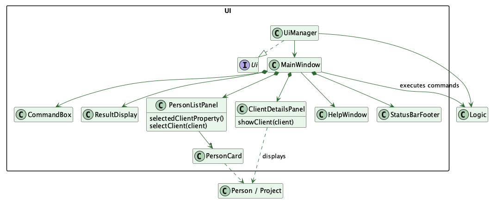
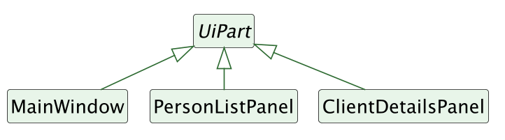
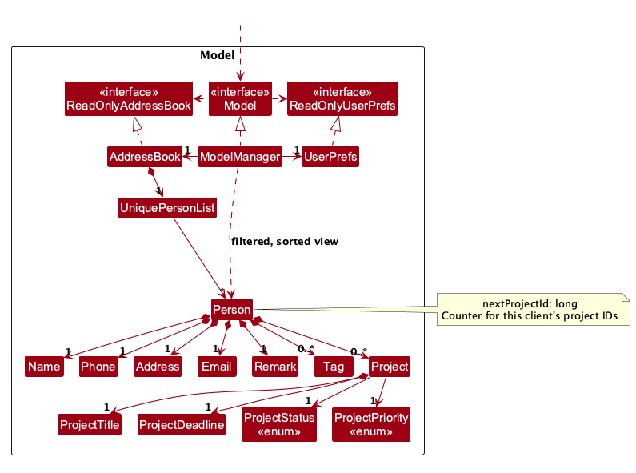
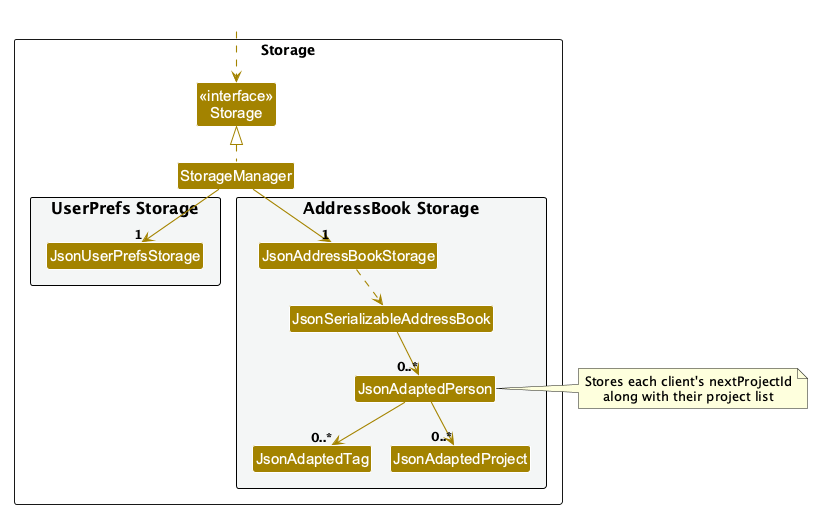
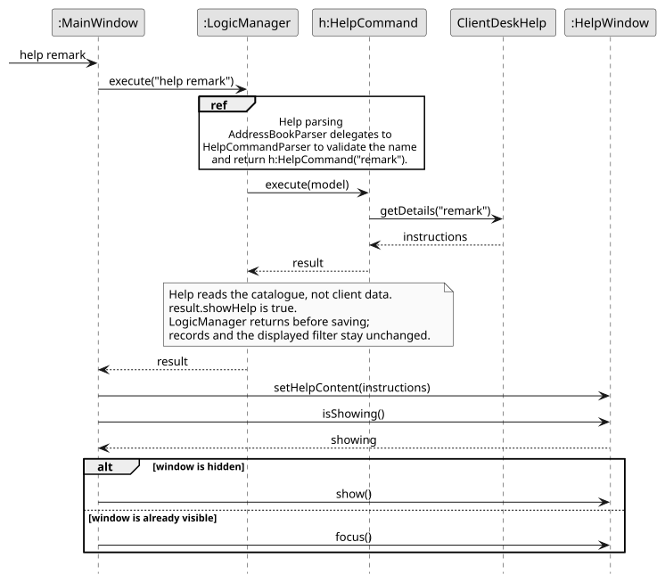
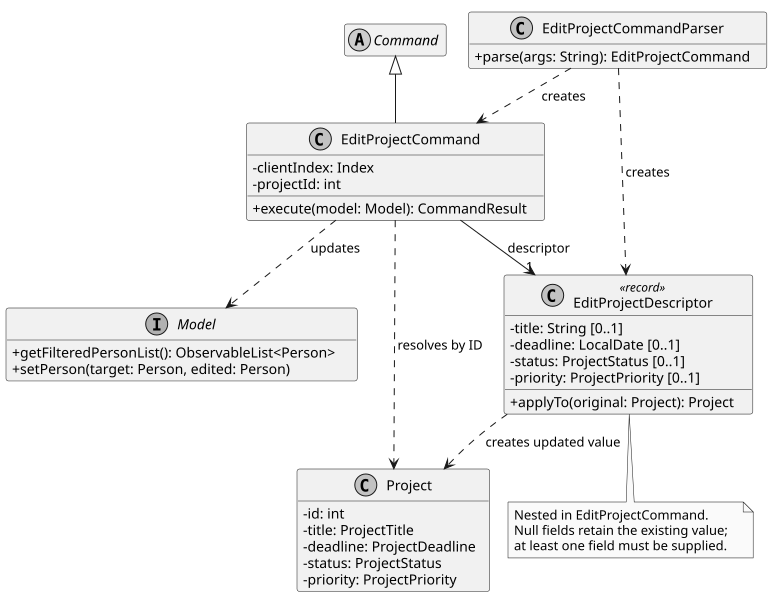
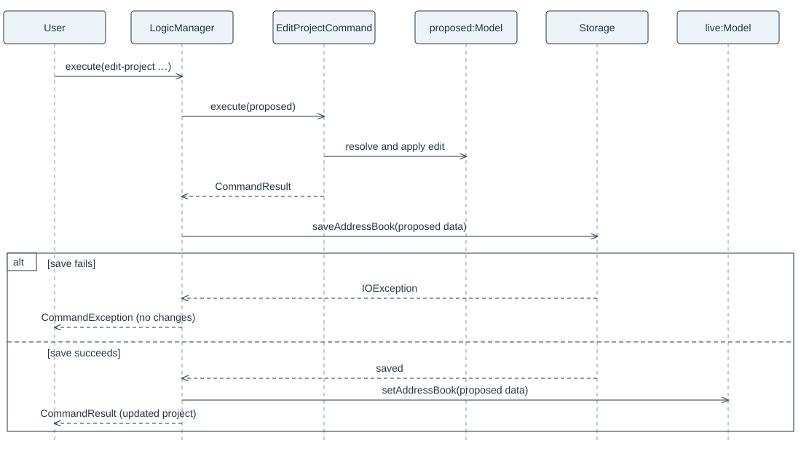

* Table of Contents
{:toc}

--------------------------------------------------------------------------------------------------------------------

## **Acknowledgements**

* Help retains the existing ClientDesk command catalogue and AddressBook-Level3 Help window.

* The `edit-project` save-before-publish flow follows the existing `delete-client` staging approach. The shared project model and JSON storage come from Anson's merged [Add Project PR #58](https://github.com/AY2627S1-CS2103T-T10-1/tp/pull/58). The Edit Project prefix scanning and whitespace trimming adapt `AddProjectCommandParser` from [commit d64842b](https://github.com/iians0n/tp/commit/d64842b07ad207b1b264f44461af6a2ba1a763ed), and its JavaFX test follows `AddProjectUiTest` from that commit. Project display in `view` retains the implementation reused from Anson's earlier [commit f5e77fa](https://github.com/iians0n/tp/commit/f5e77fa407264a274d922d6fb679e7202daa3624). These reused contributions are credited to Anson.

* The `delete-client` command and save-before-publish flow follow the command and atomic-save structure introduced for `add-client` in [team commit 332b415](https://github.com/AY2627S1-CS2103T-T10-1/tp/commit/332b415a1e13cf5dd3f1d6b8c1eeb62451060542). No source code was copied verbatim.
* The `list-clients` command and parser follow the separate client command structure established by [team commit 332b415](https://github.com/AY2627S1-CS2103T-T10-1/tp/commit/332b415a1e13cf5dd3f1d6b8c1eeb62451060542). No source code was copied verbatim.
* The atomic legacy deletion explanation and sequence diagram were developed for [issue #79](https://github.com/AY2627S1-CS2103T-T10-1/tp/issues/79). They document the save-before-publish behavior introduced by [issue #77](https://github.com/AY2627S1-CS2103T-T10-1/tp/issues/77); no external source was copied.

--------------------------------------------------------------------------------------------------------------------

## **Setting up, getting started**

Refer to the guide [_Setting up and getting started_](SettingUp.md).

--------------------------------------------------------------------------------------------------------------------

## **Design**

<div markdown="span" class="alert alert-primary">

:bulb: **Tip:** The `.puml` files used to create diagrams are in `docs/diagrams`. Refer to the [_PlantUML Tutorial_ at se-edu/guides](https://se-education.org/guides/tutorials/plantUml.html) to learn how to create and edit diagrams.
</div>

### Architecture


The ***Architecture Diagram*** given above explains the high-level design of the App.

The following provides a quick overview of the main components and their interactions.

**Main components of the architecture**

**`Main`** (consisting of classes [`Main`](https://github.com/se-edu/addressbook-level3/tree/master/src/main/java/seedu/address/Main.java) and [`MainApp`](https://github.com/se-edu/addressbook-level3/tree/master/src/main/java/seedu/address/MainApp.java)) is in charge of the app launch and shut down.
* At app launch, it initializes the other components in the correct sequence, and connects them up with each other.
* At shut down, it shuts down the other components and invokes cleanup methods where necessary.

The bulk of the app's work is done by the following four components:

* [**`UI`**](#ui-component): The UI of the App.
* [**`Logic`**](#logic-component): The command executor.
* [**`Model`**](#model-component): Holds the data of the App in memory.
* [**`Storage`**](#storage-component): Reads data from, and writes data to, the hard disk.

[**`Commons`**](#common-classes) represents a collection of classes used by multiple other components.

**How the architecture components interact with each other**

The *Sequence Diagram* below shows how the components interact with each other for the scenario where the user issues the command `delete 1`.


Each of the four main components (also shown in the diagram above),

* defines its *API* in an `interface` with the same name as the Component.
* provides its functionality through a concrete `{Component Name}Manager` class that implements the corresponding API interface.

For example, the `Logic` component defines its API in `Logic.java` and implements it in `LogicManager.java`. Other components interact with a component through its interface rather than its concrete class, preventing them from coupling to that component's implementation, as illustrated in the following partial class diagram.


The sections below give more details of each component.

### UI component

The **API** of this component is specified in [`Ui.java`](https://github.com/se-edu/addressbook-level3/tree/master/src/main/java/seedu/address/ui/Ui.java)



[PlantUML source](diagrams/UiClassDiagram.puml)

The first diagram shows an initialized UI, after `MainWindow.fillInnerParts()`.
`Logic` and `Person` are outside the UI boundary because they belong to the Logic
and Model components respectively.
Filled diamonds indicate composition; solid arrows show navigable associations;
and a dashed line with a hollow triangle shows interface realization. Multiplicities indicate how many target instances may be
associated with each source. Less important UI references are shown as typed
attributes instead of separate class boxes and arrows. `resultDisplay` and `helpWindow` are fields of `MainWindow`. `CommandBox` and
`StatusBarFooter` are omitted from this focused view; they are initialized by
`MainWindow.fillInnerParts()`. Methods and other implementation details
unrelated to selection are omitted. The method parameter shows the details panel's
use of `Person`; a separate dependency arrow is omitted to reduce clutter.

Inheritance is shown separately below to avoid crossing these relationships with
superclass arrows.



[Inheritance diagram source](diagrams/UiInheritanceDiagram.puml)

The inheritance diagram shows representative subclasses only: `MainWindow`,
`PersonListPanel` and `ClientDetailsPanel`. `CommandBox`, `ResultDisplay`,
`StatusBarFooter`, `HelpWindow` and `PersonCard` also extend `UiPart` but are omitted
from this view. Generic type arguments are omitted. The superclass name is italic
because `UiPart` is abstract; solid lines with hollow triangles point to it.

The UI consists of a `MainWindow` and its parts, such as `CommandBox`, `ResultDisplay`, `PersonListPanel`, `ClientDetailsPanel`, and `StatusBarFooter`. All of these, including `MainWindow`, inherit from the abstract `UiPart` class, which captures common behavior among classes that represent visible GUI parts.

The `UI` component uses the JavaFX UI framework. The layouts of these UI parts are defined in matching `.fxml` files in `src/main/resources/view`. For example, [`MainWindow.fxml`](https://github.com/se-edu/addressbook-level3/tree/master/src/main/resources/view/MainWindow.fxml) specifies the layout of [`MainWindow`](https://github.com/AY2627S1-CS2103T-T10-1/tp/blob/master/src/main/java/seedu/address/ui/MainWindow.java).

The `UI` component,

* executes user commands using the `Logic` component.
* listens for changes to `Model` data so that the UI can be updated with the modified data.
* keeps a reference to the `Logic` component, because the `UI` relies on the `Logic` to execute commands.
* depends on some classes in the `Model` component because it displays `Person` objects from the model.

#### Client details selection and refresh

`MainWindow` observes `PersonListPanel.selectedClientProperty()` and passes the selected
`Person` to `ClientDetailsPanel.showClient`. The read-only panel displays contact details
and projects; a null selection shows instructions, and a client with no projects shows
the project empty state.

`view`, Add Project, Edit Project and Delete Project return a `CommandResult` containing
the client to select. For project mutations, `LogicManager` saves the proposed data before
publishing it to the live model. After successful execution, `MainWindow` calls
`PersonListPanel.selectClient` with the updated client. This restores selection after the
list replacement and refreshes the details without another `view` command. Add and delete
use the same result mechanism as edit; the UI does not parse command text to identify them.

Validation or save failures produce no successful selection result and leave the selected
client and details unchanged. Deleting the selected client clears the selection and returns
the panel to its instructions. The selection is based on the actual updated client, so it
works with filtered lists and multiple clients rather than assuming the first row.

`ClientDetailsUiTest` exercises add/delete refresh, remaining and empty project lists,
invalid commands, failed saves, and selected-client deletion with both full and filtered
lists. Manual checks are recorded in `test/ui-test-plan.md`.

### Logic component

**API** : [`Logic.java`](https://github.com/se-edu/addressbook-level3/tree/master/src/main/java/seedu/address/logic/Logic.java)

Here's a (partial) class diagram of the `Logic` component:


The sequence diagram below illustrates the interactions within the `Logic` component, taking `execute("delete 1")` API call as an example.


The deletion follows a save-before-publish flow:

1. `AddressBookParser` parses `delete 1` and returns a `DeleteCommand` only after the command syntax is valid.
1. `LogicManager` recognizes `DeleteCommand` as a legacy mutation. It copies the live address book and user preferences into a proposed `ModelManager`, then gives that model the clients currently displayed by the live filter. The index therefore resolves against the same list the user saw.
1. `DeleteCommand` validates the displayed index and deletes the selected client only from the proposed model. The live model and UI have not changed at this point.
1. `LogicManager` asks `Storage` to save the proposed address book. `JsonAddressBookStorage` writes through a temporary file and replaces the existing file only after writing succeeds.
1. If saving succeeds, `LogicManager` publishes the proposed address book with `Model#setAddressBook` and returns the successful `CommandResult`. The live filter remains active and now excludes the deleted client.
1. If saving throws an `IOException`, `LogicManager` converts it to a `CommandException` and does not publish the proposal. The proposed model is discarded, while the live records, displayed filter and existing saved file remain unchanged. A later `list` command only changes the filter and does not save client data, so it cannot persist the rejected deletion.

The same staging boundary protects the inherited `add`, `edit`, `remark` and `clear` mutations. Read-only inherited commands, including `list` and `exit`, execute without saving client data.

Here are the other classes in `Logic` (omitted from the class diagram above) that are used for parsing a user command:


How the parsing works:
* When called upon to parse a user command, the `AddressBookParser` class creates an `XYZCommandParser` (`XYZ` is a placeholder for the specific command name, e.g., `AddCommandParser`). The parser uses the other classes shown above to parse the user command and create an `XYZCommand` object (e.g., `AddCommand`). The `AddressBookParser` returns that object as a `Command` object.
* All `XYZCommandParser` classes, such as `AddCommandParser` and `DeleteCommandParser`, implement the `Parser` interface so they can be treated similarly where appropriate, for example during testing.

### Model component
**API** : [`Model.java`](https://github.com/AY2627S1-CS2103T-T10-1/tp/blob/master/src/main/java/seedu/address/model/Model.java)




The `Model` component,

* stores the address book data i.e., all `Person` objects (which are contained in a `UniquePersonList` object).
  Each `Person` holds contact fields, a remark and tags, plus an immutable list of projects. A `Project` has a positive
  ID, title, deadline, status and priority. The ID belongs to that client; `Person.nextProjectId` tracks project ID
  allocation and does not decrease when a project is removed.
* stores the `Person` objects selected by the current filter in a `FilteredList`, wrapped in a `SortedList` for display.
  It exposes the displayed list as an unmodifiable `ObservableList<Person>` that both the UI and indexed commands use.
  Changes to the filter, ordering, or underlying records therefore update the same observable view.
* stores a `UserPrefs` object that represents the user’s preferences (currently, just the GUI settings). This is exposed to the outside as a `ReadOnlyUserPrefs` object.
* does not depend on any of the other three components (as the `Model` represents data entities of the domain, they should make sense on their own without depending on other components)

<div markdown="span" class="alert alert-info">:information_source: **Note:** The alternative, arguably more object-oriented, design below keeps a unique list of tags in `AddressBook`, and each `Person` references tags from that list. This lets `AddressBook` maintain one `Tag` object per unique tag instead of each `Person` holding its own `Tag` objects.<br>


</div>


### Storage component

**API** : [`Storage.java`](https://github.com/AY2627S1-CS2103T-T10-1/tp/blob/master/src/main/java/seedu/address/storage/Storage.java)



The `Storage` component,
* can save both address book data and user preference data in JSON format, and read them back into corresponding objects.
* is implemented by `StorageManager`, which delegates the actual JSON file access to `JsonAddressBookStorage` and `JsonUserPrefsStorage` (one class per data file).
* uses `JsonSerializableAddressBook` and `JsonAdaptedPerson` to convert clients to and from JSON.
  `JsonAdaptedPerson` stores each client's projects and `nextProjectId`; each project is converted by
  `JsonAdaptedProject`. Legacy client records without those fields load with no projects and the next ID set to 1.
  Stored project fields and IDs are validated before a `Person` is created, so invalid project data is rejected on load.
* depends on some classes in the `Model` component (because the `Storage` component's job is to save/retrieve objects that belong to the `Model`)

### Common classes

Classes used by multiple components are in the `seedu.address.commons` package.

--------------------------------------------------------------------------------------------------------------------

## **Implementation**

This section describes some noteworthy details on how certain features are implemented.

### Help

`ClientDeskHelp` stores the supported ClientDesk client and project command instructions in an ordered,
unmodifiable map. It supplies the overview and detailed instructions to `HelpCommand`. Each entry describes
an implemented command; planned commands have no entry. Every command routed by `AddressBookParser` has an
entry, including the legacy `add`, `edit`, `delete`, `clear` and `exit` commands. Legacy field rules are shared
between the Add and Edit entries; they intentionally differ from Add Client's phone and tag creation rules.
`HelpIntegrationTest` executes the catalogue examples with disposable JSON storage and checks Help against
unwritable storage without changing data or the displayed filter.

`HelpCommandParser` accepts zero or one command name and matches names case-insensitively. An unknown name
produces an error; multiple names produce `Usage: help [COMMAND]`. `HelpCommand` returns a result that opens
`HelpWindow`, whose scrollable text displays the instructions. The Help menu and `F1` open the overview.
`LogicManager` skips saving for Help, so viewing instructions preserves client data and the displayed filter.

The sequence below traces `help remark` from the command box to the Help window. The reference frame summarizes parsing by `AddressBookParser` and `HelpCommandParser` to keep the focus on the catalogue lookup and display flow. Result-display updates, logging and window layout details are omitted.



The parser checks the requested name against `ClientDeskHelp` before creating a `HelpCommand`. Executing that command reads the instructions and returns a `CommandResult` with `showHelp` set to `true`; it does not execute `RemarkCommand` or access client records. `LogicManager` returns this result before its save path. `MainWindow` uses the result's instructions to update `HelpWindow`, then shows or focuses the window. This separation keeps Help usable when client-data saving is unavailable and preserves the displayed filter.

With no command name, `help` returns the catalogue overview instead. The Help menu and `F1` call `MainWindow.handleHelp()` directly with the same overview, bypassing command parsing and storage. An unknown name or more than one argument causes a `ParseException` before a Help command is created; the command box displays the error and the Help window's content is unchanged. The existing Help parser, integration and UI tests cover these paths.

### Add client

`ParserUtil.parseEmail` rejects Unicode whitespace and separator characters in new command input, including `edit-client`. The stored `Email` representation retains its existing validation so records accepted by v1.4 still load and round-trip unchanged. `EmailInputIntegrationTest` checks all four email-entry commands and legacy storage compatibility.


`AddClientCommandParser` requires name, phone and email, accepts repeated tags, and rejects repeated required
prefixes or unknown prefixes. It validates the creation rules before building a `Person`. Phone formatting is
removed and tags are lowercase. The new client has the address `Not provided`, no projects and next project ID 1.

The shared `Name` validator accepts Unicode letters, marks and numbers plus the documented punctuation, with
at least one letter or number. Its 1–80 limit counts code points, including each combining mark. `ParserUtil`
applies this rule to `add-client`, legacy `add` and legacy `edit`; JSON loading uses the same validator. Spelling
is preserved without Unicode normalization, including decomposed accents. The character whitelist continues to
reject control characters, format characters and unpaired surrogates; it does not enforce mark placement.

`AddClientCommand` checks duplicates against all stored clients, including clients hidden by the current filter.
A duplicate has the same email ignoring case, or the same normalized name and phone. A matching name alone
does not prevent creation. `Person.hasSameClientIdentity()` combines the v1.4 identity comparison with Unicode `equalsIgnoreCase()` on whitespace-normalized names. Both add commands use it against the full stored list; inherited `edit` rejects new collisions, including hidden clients.

`Person.isSamePerson()` and the stored-list invariant retain v1.4 semantics so formerly accepted Unicode case pairs can load, be staged and round-trip without losing records. Unrelated edits may preserve an existing case collision; edits that introduce a new collision or violate the original identity rule are rejected before mutation.

`LogicManager` runs Add Client on a staged model and saves that model before publishing it to the live model.
If saving fails, the live data and displayed filter stay unchanged. A successful save publishes the new client,
restores the full list and selects the new entry. Copying the existing address book into the staged model retains
each existing client's projects and next project ID.

### Editing a client's email safely

`LogicManager` executes `edit-client` against a proposed model carrying the currently displayed clients. An unchanged email skips saving. Otherwise, storage must succeed before the proposed records replace the live records. This preserves the live filter, selection and details when saving fails; successful publication re-evaluates the existing filter against the new email.

`EditClientUiTest` covers a selected client found by their old email. Its failing storage stub verifies that a rejected email change cannot clear the selection or details.

### Find clients

`FindCommandParser` splits the input into keywords and rejects empty input or keywords longer than 50 Unicode
code points with `Usage: find KEYWORD [KEYWORD]...`. Validation happens before changing the displayed list.

`PersonContainsKeywordsPredicate` copies the original keywords and compiles each as a `Pattern` with
`LITERAL | CASE_INSENSITIVE | UNICODE_CASE`. `Matcher.find()` applies locale-independent Unicode case matching to
substrings, including Turkish I variants, Greek sigma variants and supplementary letters. Literal patterns preserve
punctuation; matching does not remove accents or expand `ß` to `ss`.
Every keyword must be a substring of the same client's name, phone, email, or tags. Keywords may match different
fields. Separate field, tag, and substring helpers keep matching at one level of abstraction.

`ModelManager` wraps its `FilteredList` in a `SortedList`, ordered case-insensitively by name and then by the client's
position in the stored address book. Sorting leaves stored records in creation order. The UI and indexed commands
share this displayed list, so editing or deleting index 1 always targets the first visible client.

`FindCommand` displays `Found <number> matching clients.` when matches exist. Otherwise, it restores the full list
and displays `No clients matched: <keywords>.`, preserving keyword case and joining keywords with single spaces.
Each search considers the full address book. `LogicManager` skips saving for `FindCommand` because search only
changes the view. `HelpCommand` also skips saving because it only displays instructions.
Other commands keep their existing saving behavior.

### Add project

`AddProjectCommandParser` creates `AddProjectCommand` from a displayed client index and validated project fields.
The title and deadline are required; status defaults to `NOT_STARTED` and priority defaults to `MEDIUM`.
`ProjectStatus` represents the finite progress states; creation rejects `COMPLETED` while storage accepts it for
future project editing. `ProjectPriority` represents the three priority levels.

#### Validation and identity

`ProjectTitle` counts Unicode code points, rejects control/format characters and unpaired surrogates, and requires
a letter or number. Its display value retains internal spacing. `ProjectTitle.isSameTitle` collapses Unicode spaces
and matches either the existing `Locale.ROOT` lowercase key or `String.equalsIgnoreCase`. This covers Unicode
case variants such as dotless I, final sigma and supplementary letters without expanding `ß` to `ss`.
`ProjectDeadline` accepts only an ASCII, strict ISO calendar date in
years 0001–9999; impossible dates are not normalized into another day.

The parser recognizes known prefixes at whitespace boundaries, allowing parameter reordering and literal slash
text such as `UI/UX` in titles. Known parameter prefixes are reserved delimiters. It rejects repeated prefixes,
invalid or overflowing indexes and invalid scalar values. `AddressBookParser` retains raw arguments for
`add-project` so its outer trimming cannot hide a trailing title control character.

Each immutable `Person` owns an immutable list of `Project` values and a persisted `nextProjectId`. The constructor
checks unique positive IDs, unique v1.4 normalized title/deadline pairs and a counter greater than every saved ID.
IDs are independent between clients. The counter can reach `Integer.MAX_VALUE + 1L` as an exhausted sentinel;
the command then reports exhaustion instead of overflowing. Deleting a project retains the counter, so a deleted
ID is never reused. Existing client edit and remark commands preserve both fields.

#### Saving a project

1. `LogicManager` copies the live address book into a proposed `ModelManager`.
2. It limits the proposed displayed list to the currently visible clients. The shared name/creation-order comparator
   keeps their indexes aligned with the live sorted list.
3. `AddProjectCommand` checks the target and duplicate key, proposes the next ID, and replaces the immutable client
   in the proposed model. It uses a `Clock` to determine whether to append the overdue warning.
4. `JsonAddressBookStorage` serializes the proposed data to a temporary file and atomically replaces the destination.
5. Only after the save succeeds does `LogicManager` publish the proposed address book and return success.
   The live search predicate is retained; project fields do not change client-search matching.

An `IOException` produces the project save-failure message without publishing data, list changes or ID allocation.
Immutable values prevent the proposed transaction from mutating the live snapshot.

#### Deleting a project

`DeleteProjectCommandParser` accepts a displayed client index and a positive project ID. The command resolves the
index against the current displayed list, then searches only that client's projects. It creates a replacement
client with the selected project removed and the existing `nextProjectId` retained. `LogicManager` performs this
operation in a proposed model, saves the proposed address book, and publishes it only after storage succeeds.
An invalid index, unknown client-scoped ID or failed save leaves the live model and its filter unchanged.

#### Persistence and compatibility

`JsonAdaptedProject` validates the original JSON token types before constructing model values. Numeric strings,
fractional IDs, invalid enums, impossible dates and missing/null project fields fail loading. `JsonAdaptedPerson`
rejects malformed project collections, duplicate IDs/keys and stale counters. Omitted project fields remain valid
for legacy files, with no projects and a next ID of 1. Nonempty project data must include its saved counter. Serialization
writes both `projects` and `nextProjectId` for all clients. Project lists and counters must be retained by any future
client-copy operation, including undo snapshots.

Storage retains v1.4's `ProjectTitle.normalizedValue()` validation key so previously accepted Unicode title pairs
remain readable and survive saving without changing their spelling, IDs or counter. New additions and title/deadline
edits use the broader duplicate matching above. Status/priority edits and deletion remain available for existing
pairs; duplicate IDs and pairs already invalid under v1.4 still fail loading.

This subsection describes project creation and deletion. Project editing is described in the Edit project
subsection below. Undo, notes, follow-ups and agenda are planned.

#### Test coverage

The project unit tests check title/date boundaries, locale-independent identity, enums, immutable lists and ID
exhaustion. Parser tests cover shuffled/case-insensitive prefixes, defaults, duplicate fields, literal slash text,
control characters, invalid dates and index overflow. Storage tests exercise legacy files, round trips, malformed
JSON token types, duplicate project data and retired IDs.

`AddProjectCommandIntegrationTest` exercises the real parser/logic/storage path, including filtered indexes,
restart allocation, failed saves with unchanged file bytes and no live-list events, retry and
existing client edits/deletion. `AddProjectUiTest` enters commands through the JavaFX command box and verifies
feedback, retained filtering, saved project data and duplicate errors.

`DeleteProjectCommandIntegrationTest` verifies displayed indexes, client-scoped IDs, persisted deletion without
counter reuse, unchanged file bytes and live-list events on save failure, retry, and preservation through client
editing and `list-clients`. Command and parser tests cover successful deletion, invalid indexes and IDs, and
argument validation.
### Edit project

`EditProjectCommandParser` reads a displayed client index and a stable, client-local project ID. It rejects repeated prefixes and invalid identifiers/field values and creates an immutable `EditProjectDescriptor` containing only supplied fields. `ProjectTitle` and `ProjectDeadline` centralize title/date validation; `ProjectStatus` and `ProjectPriority` provide the persisted command vocabulary. The descriptor can represent completion, reopening, and any combination of title/deadline/priority changes. The parser shares the `CliSyntax` prefix constants and unsigned ASCII identifier form with Add Project. Known prefixes delimit fields; other slash-containing title words remain literal text. Boundary trimming uses linear scans so oversized inputs with long internal space runs are rejected promptly.

`EditProjectCommand` finds the client in the displayed list and the project by ID within that client. It applies the descriptor without changing the ID or other projects, and checks for conflicting work under that client when the title or deadline changes. An exact no-op returns without mutation. Both failed lookup and duplicate validation happen before updating the proposed client.

`LogicManager` executes this command against a staged `ModelManager` copied from the live data. The staging filter contains exactly the clients visible when the command was submitted, so the displayed index resolves consistently even after a search. Only after `Storage.saveAddressBook` succeeds does it publish the staged data to the live model; the live filter itself is retained. A save failure leaves the live model, filter and persisted data unchanged. `JsonAddressBookStorage` already uses atomic file replacement, which protects the original saved file during write failures.

The class diagram shows the command's dependencies and its immutable descriptor. `EditProjectDescriptor` is a nested Java record; its nullable fields represent omitted updates. Only relationships relevant to editing are shown.



The sequence below starts after parsing a valid edit that changes data. `LogicManager` prepares the proposed model and its displayed-client filter before executing the command. Lookup, duplicate and no-op paths are omitted for readability; they return or throw before saving.



* **Model:** `Person` owns an immutable list of immutable `Project` values, each with `id`, `title`, `deadline`, `status` and `priority`. IDs must be positive and unique within each client. Equality includes project data so snapshots and no-op checks detect edits correctly. `withProjects` copies the contact details, remark and tags and retains the per-client `nextProjectId` allocation counter during an edit. Existing contact and remark edits preserve project lists.
* **Storage:** `JsonAdaptedProject` validates all five stored fields through the same domain rules as parsing. `JsonAdaptedPerson` reads an absent `projects` field as an empty list for legacy compatibility and requires a persisted `nextProjectId` for nonempty project lists; legacy clients without projects default to ID 1. Explicit null project lists, invalid fields/counters, duplicate IDs, duplicate work and null list entries fail through `IllegalValueException`/`DataLoadingException`. `view` includes project IDs and current values so users can identify the edit target.
* **Design choice:** staging avoids showing an unsaved change or depending on a rollback after failure. It copies the client collection for each edit, trading modest allocation for a clear failure contract. Immutable values make shallow snapshots safe. Project ID allocation and project creation belong to Add Project, not this command. Editing never consumes an ID.
* **Shared project support:** Edit Project uses the project values, client collection/counter and JSON schema introduced by Add Project. The edit command preserves `nextProjectId`; it neither allocates a project ID nor creates a project.

This feature implements user stories **16** (status and completion), **25** (updating priority) and **33** (title/deadline changes). UC04 describes its complete interaction; the manual-testing appendix covers its acceptance and failure cases.

Automated tests cover partial/full edits, filtered client indexes, client-local non-consecutive IDs, completion/reopening, duplicates, invalid input, no-op saves, persistence/reload, save/permission failures, legacy JSON, invalid stored data, immutability and preservation through existing client edits. `AddEditProjectIntegrationTest` exercises Add → Edit → Restart → Add → Reopen with stable IDs and duplicate-update rejection. `EditProjectUiTest` submits commands through the JavaFX command box and checks edited-client selection, feedback, filter retention, project display, persistence and invalid-priority rejection.

### \[Proposed\] Undo/redo feature

#### Proposed Implementation

The proposed undo/redo mechanism is facilitated by `VersionedAddressBook`. It extends `AddressBook` with an undo/redo history, stored internally as an `addressBookStateList` and `currentStatePointer`. Additionally, it implements the following operations:

* `VersionedAddressBook#commit()` — Saves the current address book state in its history.
* `VersionedAddressBook#undo()` — Restores the previous address book state from its history.
* `VersionedAddressBook#redo()` — Restores a previously undone address book state from its history.

These operations are exposed in the `Model` interface as `Model#commitAddressBook()`, `Model#undoAddressBook()` and `Model#redoAddressBook()` respectively.

Given below is an example usage scenario and how the undo/redo mechanism behaves at each step.

Step 1. The user launches the application for the first time. The `VersionedAddressBook` will be initialized with the initial address book state, and the `currentStatePointer` pointing to that single address book state.


Step 2. The user executes `delete 5` command to delete the 5th person in the address book. The `delete` command calls `Model#commitAddressBook()`, causing the modified state of the address book after the `delete 5` command executes to be saved in the `addressBookStateList`, and the `currentStatePointer` is shifted to the newly inserted address book state.


Step 3. The user executes `add n/David …​` to add a new person. The `add` command also calls `Model#commitAddressBook()`, causing another modified address book state to be saved into the `addressBookStateList`.


<div markdown="span" class="alert alert-info">:information_source: **Note:** If a command fails its execution, it will not call `Model#commitAddressBook()`, so the address book state will not be saved into the `addressBookStateList`.

</div>

Step 4. The user now decides that adding the person was a mistake, and decides to undo that action by executing the `undo` command. The `undo` command will call `Model#undoAddressBook()`, which will shift the `currentStatePointer` once to the left, pointing it to the previous address book state, and restores the address book to that state.


<div markdown="span" class="alert alert-info">:information_source: **Note:** If the `currentStatePointer` is at index 0, pointing to the initial AddressBook state, then there are no previous AddressBook states to restore. The `undo` command uses `Model#canUndoAddressBook()` to check if this is the case. If so, it will return an error to the user rather
than attempting to perform the undo.

</div>

The following sequence diagram shows how an undo operation goes through the `Logic` component:


<div markdown="span" class="alert alert-info">:information_source: **Note:** The lifeline for `UndoCommand` should end at the destroy marker (X), but due to a limitation of PlantUML, it continues to the end of the diagram.

</div>

Similarly, how an undo operation goes through the `Model` component is shown below:


The `redo` command does the opposite — it calls `Model#redoAddressBook()`, which shifts the `currentStatePointer` once to the right, pointing to the previously undone state, and restores the address book to that state.

<div markdown="span" class="alert alert-info">:information_source: **Note:** If the `currentStatePointer` is at index `addressBookStateList.size() - 1`, pointing to the latest address book state, then there are no undone AddressBook states to restore. The `redo` command uses `Model#canRedoAddressBook()` to check if this is the case. If so, it will return an error to the user rather than attempting to perform the redo.

</div>

Step 5. The user then decides to execute the command `list`. Commands that do not modify the address book, such as `list`, will usually not call `Model#commitAddressBook()`, `Model#undoAddressBook()` or `Model#redoAddressBook()`. Thus, the `addressBookStateList` remains unchanged.


Step 6. The user executes `clear`, which calls `Model#commitAddressBook()`. Since the `currentStatePointer` is not pointing at the end of the `addressBookStateList`, all address book states after the `currentStatePointer` will be purged. Reason: It no longer makes sense to redo the `add n/David …​` command. This is the behavior that most modern desktop applications follow.


The following activity diagram summarizes what happens when a user executes a new command:


#### Design considerations:

**Aspect: How undo & redo execute:**

* **Alternative 1 (current choice):** Saves the entire address book.
  * Pros: Easy to implement.
  * Cons: May have performance issues in terms of memory usage.

* **Alternative 2:** Individual command knows how to undo/redo by
  itself.
  * Pros: Will use less memory (e.g. for `delete`, just save the person being deleted).
  * Cons: We must ensure that the implementation of each individual command is correct.

_{more aspects and alternatives to be added}_

### \[Proposed\] Data archiving

_{Explain here how the data archiving feature will be implemented}_


--------------------------------------------------------------------------------------------------------------------

## **Documentation, logging, testing, dev-ops**

* [Documentation guide](Documentation.md)
* [Testing guide](Testing.md)
* [Logging guide](Logging.md)
* [DevOps guide](DevOps.md)

--------------------------------------------------------------------------------------------------------------------

## **Appendix: Requirements**

### Product scope

**Target user profile**:

* is a freelancer or independent professional managing client relationships
* needs to organize client details, projects, deadlines and follow-ups
* prefers a desktop app with local data storage
* can type fast and prefers typed commands to mouse interactions

**Value proposition**: Keep client details and related work in one place, using typed commands to find and update records.


### User stories

The stories below describe the needs of freelancers and independent professionals using ClientDesk.
They include requirements considered for later versions; inclusion here does not mean a feature has been implemented.

Priorities: High (must have) - `* * *`, Medium (nice to have) - `* *`, Low (unlikely to have) - `*`.
High-priority stories support the core workflows in the agreed MVP feature specification.
Medium- and low-priority stories record optional enhancements and deferred requirements.

IDs 1-30 refer to the original requirements list. Overlapping stories are combined while retaining their IDs.
IDs 31-36 capture needs made explicit by the feature specification and usage narrative.

| ID | Priority | As a ... | I want to ... | So that I can ... |
| --- | --- | --- | --- | --- |
| 1 | `* * *` | freelancer with several ongoing projects | view pending projects in deadline order | decide which work needs my attention first |
| 2 | `* * *` | freelancer | add a client with their contact details | keep a record of the people and businesses I work with |
| 3 | `* *` | freelancer seeking repeat business | identify inactive clients whose projects have ended | contact them about new opportunities |
| 4, 27, 28, 29 | `* * *` | freelancer | edit a client's name, phone number or email address | keep their contact information accurate |
| 5 | `*` | freelancer working with several people at one organization | associate multiple contact people with one client record | keep related contacts together |
| 6 | `* * *` | freelancer | record notes about a client | remember information from previous interactions |
| 7 | `* *` | freelancer with many clients | choose to sort clients by name, follow-up date or date added | browse records in the order useful to me |
| 8, 12 | `* * *` | freelancer working across industries and project types | add or remove client tags | keep the categories of my professional relationships accurate |
| 9 | `* *` | freelancer | export my client records | keep a backup or use the information outside ClientDesk |
| 10 | `* * *` | freelancer | delete a client record I no longer need | remove unwanted records from my client list |
| 11 | `* * *` | freelancer | find clients using partial names, phone numbers, email addresses or tags | retrieve a client's information without scanning the whole list |
| 13 | `* * *` | freelancer | set or update a client's follow-up date and details | remember when and why to contact them |
| 14 | `* *` | freelancer | archive inactive clients and restore them when needed | focus on active relationships while retaining access to old records |
| 15 | `* * *` | freelancer | record notes about a client's ongoing project | retain the requirements and decisions relevant to that work |
| 16 | `* * *` | freelancer | update a project's status, including marking it completed | distinguish work still in progress from finished work |
| 17 | `* *` | freelancer | receive an alert when a client follow-up is due | notice important actions without repeatedly checking the agenda |
| 18 | `* *` | freelancer reviewing several clients | compare the details of multiple clients at once | review related records without repeatedly switching between them |
| 19 | `* * *` | freelancer | view a client's contact details, tags, projects, notes and follow-up | recover the context needed to work with or contact that client |
| 20 | `* * *` | freelancer | identify overdue follow-ups and the clients they belong to | contact clients whose follow-ups I have missed |
| 21 | `*` | freelancer using client tags | distinguish tags by colour | recognize client categories at a glance |
| 22 | `* * *` | freelancer who made an accidental change | undo my most recent data-changing action | recover the previous records without re-entering them |
| 23 | `* *` | freelancer | view a summary of my clients and pending work | understand my current business workload |
| 24 | `*` | freelancer seeking new clients | receive prospective clients' enquiries through ClientDesk | keep incoming leads together with my client records |
| 25 | `* * *` | freelancer with competing commitments | set or update a project's priority | identify work that matters most when deadlines alone are insufficient |
| 26 | `* * *` | freelancer | add a project with a deadline under its client | track that client's deliverables and when they are due |
| 30 | `* *` | freelancer | view a summary of completed projects | review my past work and output |
| 31 | `* * *` | new or returning user | view command descriptions, formats and examples | learn or recall how to use ClientDesk |
| 32 | `* * *` | freelancer | list my clients in name order with their contact details and tags | browse my records and choose the client I need to work with |
| 33 | `* * *` | freelancer | edit a project's title or deadline | keep the recorded work accurate when plans change |
| 34 | `* * *` | freelancer planning upcoming work | view upcoming projects and client follow-ups together in an agenda | plan my work and client communications in one place |
| 35 | `* * *` | freelancer returning to ClientDesk | retrieve the records saved during my previous session | continue managing clients without re-entering their information |
| 36 | `* *` | freelancer with many clients | filter clients by tags or by whether they have pending or overdue work | focus on the relationships relevant to my current task |

### Use cases

(For all use cases below, the **System** is `ClientDesk` and the **Actor** is a freelancer or independent
professional, unless specified otherwise.)

#### UC01: Record new work for a client

**Preconditions:** ClientDesk is running and the client has already been added.

**MSS**

1.  User searches for the client by name.
2.  ClientDesk shows the matching client.
3.  User views the client's details.
4.  User adds a project with a title and deadline to the client.
5.  ClientDesk validates and saves the project.
6.  User adds a note describing the latest client interaction.
7.  ClientDesk validates and saves the note.
8.  User sets a follow-up date and optional follow-up details for the client.
9.  ClientDesk validates and saves the follow-up.
10. User opens the agenda.
11. ClientDesk shows the project and follow-up in date order.

    Use case ends.

**Extensions**

* 2a. No client matches the search.

  * 2a1. ClientDesk informs the user that no clients matched and restores the full client list.
  * 2a2. User adds the client using their name, phone number and email address.
  * 2a3. ClientDesk validates and saves the new client.

    Use case resumes at step 3.

* 3a. The selected client index is invalid.

  * 3a1. ClientDesk informs the user that there is no client at that index.

    Use case resumes at step 1.

* 5a. The project details are invalid or duplicate an existing project for the client.

  * 5a1. ClientDesk shows the relevant error and does not create the project.

    Use case resumes at step 4.

* 7a. The note is invalid or cannot be saved.

  * 7a1. ClientDesk shows the relevant error and does not add the note.

    Use case resumes at step 6.

* 9a. The follow-up date or details are invalid, or the follow-up cannot be saved.

  * 9a1. ClientDesk shows the relevant error and retains the previous follow-up.

    Use case resumes at step 8.

#### UC02: Resolve overdue work

**Preconditions:** At least one client has an overdue project or follow-up in ClientDesk.

**MSS**

1.  User requests to view overdue agenda items.
2.  ClientDesk shows all pending projects and follow-ups dated before today.
3.  User selects an overdue client's record.
4.  ClientDesk shows the client's projects, recent notes, tags and follow-up details.
5.  User replaces the client's follow-up with a new date and optional details.
6.  ClientDesk validates and saves the new follow-up.
7.  User marks the overdue project as completed.
8.  ClientDesk validates and saves the updated project.
9.  User requests to view overdue agenda items again.
10. ClientDesk no longer shows the completed project or rescheduled follow-up as overdue.

    Use case ends.

**Extensions**

* 2a. There are no overdue projects or follow-ups.

  * 2a1. ClientDesk informs the user that there are no pending items in the period.

    Use case ends.

* 3a. The selected client index is invalid.

  * 3a1. ClientDesk informs the user that there is no client at that index.

    Use case resumes at step 2.

* 6a. The follow-up date or details are invalid, or the follow-up cannot be saved.

  * 6a1. ClientDesk shows the relevant error and retains the previous follow-up.

    Use case resumes at step 5.

* 8a. The project ID or updated status is invalid, or the project cannot be saved.

  * 8a1. ClientDesk shows the relevant error and retains all previous project values.

    Use case resumes at step 7.

#### UC03: Delete a client permanently

**Preconditions:** At least one client exists.

**MSS**

1.  User lists all clients.
2.  ClientDesk shows the clients with their current indexes.
3.  User deletes a client by index.
4.  ClientDesk saves the deletion of the client and all associated projects, remarks and tags.
5.  ClientDesk confirms that the client was deleted.

    Use case ends.

**Extensions**

* 3a. The selected client index is invalid.

  * 3a1. ClientDesk informs the user that there is no client at that index.

    Use case resumes at step 2.

* 4a. ClientDesk cannot save the deletion.

  * 4a1. ClientDesk informs the user that the client could not be deleted and makes no changes.

    Use case resumes at step 3.

#### UC04: Update an existing project

**Preconditions:** The client and project are already stored in ClientDesk.

**MSS**

1. User requests the client's details.
1. ClientDesk shows the client's projects and their IDs.
1. User identifies a project and supplies changes to its title, deadline, status or priority.
1. ClientDesk validates and saves the changes.
1. ClientDesk confirms the updated project details.

   Use case ends.

**Extensions**

* 1a. The client cannot be found in the displayed list.

  * 1a1. ClientDesk informs the user that the selected client is invalid.

    Use case resumes at step 1.

* 3a. The specified client or project does not exist.

  * 3a1. ClientDesk reports the missing target and makes no changes.

    Use case resumes at step 1.

* 3b. No field is supplied, or the supplied changes are invalid.

  * 3b1. ClientDesk explains the input error and makes no changes.

    Use case resumes at step 3.

* 4a. The changes duplicate another project's normalized title and deadline under this client.

  * 4a1. ClientDesk reports the conflict and makes no changes.

    Use case resumes at step 3.

* 4b. All supplied values already match the stored project.

  * 4b1. ClientDesk reports that no changes are needed and does not save.

    Use case ends.

* 4c. ClientDesk cannot save the changes.

  * 4c1. ClientDesk reports the save failure and retains the previous live and saved data.

    Use case resumes at step 3.

### Non-Functional Requirements

1.  ClientDesk should work on any _mainstream OS_ with Java `25` or above installed.
2.  ClientDesk should support at least 1000 clients and their associated projects, notes, tags and follow-ups without
    data loss.
3.  ClientDesk should respond to `list`, `find`, `view` and `agenda` commands within 1 second under typical usage with
    1000 clients stored.
4.  All client, project, note, follow-up and agenda workflows should be completable using only the keyboard.
5.  A new user who is familiar with command-line applications should be able to complete the feature list's
    end-to-end acceptance scenarios within 15 minutes by referring to the User Guide.
6.  ClientDesk should save each successful data-changing command before displaying its success message and should
    preserve the saved data after a normal shutdown and restart.
7.  A failed save or invalid command should not cause a partial update or modify previously saved data.
8.  A failed search, details load or agenda computation should retain the previously displayed information instead
    of leaving the user with an empty or unusable view.

### Glossary

* **Agenda**: A chronological view that brings together upcoming and overdue project deadlines and follow-ups.
* **Client**: A person or organization that receives the user's professional services and whose information is managed in ClientDesk.
* **Customer relationship management (CRM)**: The practice of organizing client information and interactions to manage ongoing professional relationships.
* **Follow-up**: A dated action that the user plans to carry out for a client.
* **Mainstream OS**: Windows, Linux, Unix, or macOS
* **Project**: A piece of work undertaken for a client and tracked by its status, priority, and optional deadline.

--------------------------------------------------------------------------------------------------------------------

## **Appendix: Instructions for manual testing**

Given below are instructions to test the app manually.

<div markdown="span" class="alert alert-info">:information_source: **Note:** These instructions only provide a starting point for testers to work on;
testers are expected to do more *exploratory* testing.

</div>

### Launch and shutdown

1. Initial launch

   1. Download the JAR file and copy it into an empty folder.

   1. Double-click the JAR file.<br>
      Expected: The GUI opens with a set of sample contacts. The window size may not be optimal.

1. Saving window preferences

   1. Resize the window to an optimal size. Move the window to a different location. Close the window.

   1. Relaunch the app by double-clicking the JAR file.<br>
       Expected: The most recent window size and location are retained.

1. _{ more test cases …​ }_

### Viewing help

1. Enter `help`, then `help edit-project`.<br>
   Expected: A scrollable Help window shows the supported ClientDesk client and project command overview,
   then Edit Project's format, rules and examples.
1. Enter `help EDIT-CLIENT` and `help remark`.<br>
   Expected: Edit Client describes email editing. Remark describes setting or clearing a client's remark.
1. Enter `help add`, `help edit`, `help delete`, `help clear` and `help exit` separately, then repeat with
   mixed-case names such as `HeLp AdD`.<br>
   Expected: Each opens that command's format, rules and examples. `help clear` does not delete data and
   `help exit` does not close the app. Add/Edit explain the lowercase prefixes and legacy field rules;
   Clear warns that it removes even clients hidden by a search, without confirmation or undo.
1. Enter `help undo`, `help agenda` and `help add-client edit-project` separately.<br>
   Expected: The first two report an unknown command. The last reports `Usage: help [COMMAND]`.
1. Enter `find alex`, note the displayed clients, then open Help through the command, Help menu and `F1`.<br>
   Expected: Each route opens Help. Closing it leaves the displayed clients and their data unchanged.

### Setting a remark

1. On disposable data with a displayed client, enter `remark 1 r/Keep this reminder`, then `view 1`.<br>
   Expected: the selected client has that remark.
1. Enter `remark 1 r/Call Monday r/Call Tuesday`, then `remark 1 r/Important reminder r/`.<br>
   Expected: both commands report a repeated `r/` prefix; `view 1` still shows `Keep this reminder`.
1. Enter `remark 1 r/`, then `view 1`.<br>
   Expected: the remark is empty. The legacy `remark 1` shorthand also clears it.

### Adding a client

Run these cases in a disposable folder containing the JAR, using Java 25. Keep that folder separate from your
normal ClientDesk data. Start the application with `java -jar addressbook.jar` from that folder.

1. Enter `add-client n/Weeknine Studio p/+65 8123 4567 e/studio@weeknine.sg t/web-design`.<br>
   Expected: The client is saved and selected. Its phone is `6581234567`, address is `Not provided`, and it has no projects.
1. Enter `find Weeknine Studio`, then `add-project 1 title/Website deadline/2026-12-01`.<br>
   Expected: The studio receives project ID 1.
1. Enter `add-client n/Weeknine Partner p/92345678 e/partner@weeknine.sg`, then `find Weeknine Studio` and `view 1`.<br>
   Expected: The partner is added. The studio still has its Website project with ID 1.
1. Close and restart the application in the same folder. Enter `find Weeknine Studio`,
   then `add-project 1 title/Support deadline/2026-12-02`.<br>
   Expected: The Website project remains and the Support project receives ID 2.
1. Enter `find Weeknine Partner`, then
   `add-client n/Another Studio p/93456789 e/STUDIO@weeknine.sg`.<br>
   Expected: A duplicate-client error appears even though the studio is hidden by the filter. No client is added.
1. Enter `add-client n/Invalid Client p/123 e/invalid@weeknine.sg`.<br>
   Expected: A phone-validation error appears and no client is added.

### Deleting a person

1. Deleting a person while all persons are being shown

   1. Prerequisites: List all persons using the `list` command, with multiple persons in the list.

   1. Test case: `delete 1`<br>
      Expected: The first contact is deleted from the list. The status message shows the deleted contact's details.

   1. Test case: `delete 0`<br>
      Expected: No person is deleted. The status message shows error details.

   1. Other incorrect delete commands to try: `delete`, `delete x`, `...` (where x is larger than the list size)<br>
      Expected: Similar to previous.

1. _{ more test cases …​ }_

### Deleting a client

1. Test case: `delete-client 1`<br>
   Expected: The first client in the displayed list is removed, a success message names the client, and the change is saved.
1. Test case: `delete-client 0` or `delete-client x`.<br>
   Expected: A usage error is shown and no client is deleted.
1. Test deletion from a filtered list using disposable test data:
   1. Add `add-client n/AlphaDeleteTarget p/91234567 e/alpha-delete-target@example.com` and
      `add-client n/AlphaDeleteKeep p/92345678 e/alpha-delete-keep@example.com`.
      Both commands must succeed; start with fresh test data if either client already exists.
   1. Enter `find AlphaDeleteTarget`.<br>
      Expected: Exactly one match, named AlphaDeleteTarget. Check this before deleting;
      a search with no matches restores the full list and is not a valid setup for this test.
   1. Enter `delete-client 1`.<br>
      Expected: `Deleted client: AlphaDeleteTarget.` and an empty filtered list.
   1. Enter `find AlphaDeleteKeep`.<br>
      Expected: Exactly one match, named AlphaDeleteKeep. Other clients remain unchanged.
1. Enter `delete-client 999` when fewer than 999 clients are displayed.<br>
   Expected: An invalid client index error is shown and no client is deleted.
### Listing clients

1. Add clients with different names, then enter `list-clients`.<br>
   Expected: All clients are shown in case-insensitive name order; equal names retain creation order.
1. Enter `find acme`, then `list-clients`.<br>
   Expected: The search filter is cleared and the full client list is shown.
1. Enter `list-clients extra`.<br>
   Expected: A usage error is shown and the displayed list is unchanged.

### Finding clients with Unicode names

In a disposable data folder, run `add-client n/Işık Studio p/81234567 e/isik@example.com t/startup` and
`add-client n/Beacon Design p/82345678 e/beacon@example.com`. Record the saved data file's contents before searching.

1. Enter `find IŞIK`.<br>
   Expected: Only `Işık Studio` is shown, with `Found 1 matching clients.`. The saved file is unchanged.
1. Enter `find ŞI START`.<br>
   Expected: The same client is found through partial matches across its name and tag.
1. Enter `find IŞIK missing`.<br>
   Expected: `No clients matched: IŞIK missing.` is shown and the full list is restored. The saved file is unchanged.
1. Add a client named `ΟΣ`, then enter `find ς`.<br>
   Expected: `ΟΣ` is found despite the different Unicode sigma case form.

### Adding projects

Use a disposable data folder for these checks. Create two clients with different emails, and use `list-clients`
to see their current indexes.

1. Run `add-project 1 title/Website redesign deadline/2026-10-15`.
   Expected: success with project ID 1. After exiting, inspect the disposable data file for the title, deadline,
   default `not-started` status and `medium` priority. A past date also shows the overdue warning.
2. Add another project for client 1, then the same first title/date for client 2.
   Expected: client 1 receives ID 2, client 2 receives ID 1. Restart and add another project; the saved counters continue.
3. Run `find` for the second client, then add a project at displayed index 1.
   Expected: only that client receives the project and the filter remains active.
4. Repeat a saved title/date with changed capitalization, repeated spaces, status or priority.
   Expected: duplicate error; no new project and no consumed ID. A different date is accepted.
5. Try `deadline/2026-02-29`, `deadline/2026-04-31`, `status/completed`, an empty title, a 101-character title,
   repeated prefixes, `CLIENT_INDEX` values 0, -1, 1.5 and 2147483648, and an index not in the displayed list.
   Expected: an actionable error with unchanged data. A valid leap day such as 2028-02-29 is accepted.
6. In a disposable copy, make the containing data directory unwritable and attempt another addition.
   Expected: `Project could not be saved. No changes were made.`; data, filter and project count stay unchanged.
   Restore the directory permissions and retry; the same proposed ID remains available.
7. Edit the client's email, use the inherited `edit` and `remark` commands, then restart.
   Expected: all projects and their IDs remain. Deleting a client removes its projects without affecting another client.

### Deleting projects

1. Create two clients, then add project ID 1 to each. Run `delete-project 1 1`.
   Expected: only the first displayed client's project is removed; the other client's ID 1 remains.
2. Filter the client list and delete a project using its filtered client index. Run `list-clients` afterwards.
   Expected: the selected project is gone, the filter remains until `list-clients`, and the full client list is intact.
3. Try project ID 0, an unknown ID, and a client index outside the displayed list.
   Expected: each command reports an error without changing the saved data.
4. Delete the highest project ID from a client and add another project.
   Expected: the new project receives the next unused ID; the deleted ID is not reused.
5. In a disposable copy, make the containing data directory unwritable and attempt deletion.
   Expected: `Project could not be deleted. No changes were made.`; project data, file bytes and filter remain unchanged.
   Restore permissions and retry; the project is deleted successfully.

### Saving data

1. Dealing with missing/corrupted data files

   1. _{Explain how to simulate missing or corrupted data files and state the expected behavior.}_

1. _{ more test cases …​ }_

### Editing a project

**Setup:** Use Java 25 and a freshly built JAR in an isolated test folder. Create its `data` subfolder and copy [`edit-project-clients.json`](files/edit-project-clients.json) to `data/addressbook.json` before starting the app. Launch from that folder, for example with `java -jar addressbook.jar`. Do not replace a running application's data file. This fixture provides existing projects even before Add Project is integrated. Run the following steps in order.

The fixture has two clients, Acme Studio and Beacon Design. Each has project #11; Acme also has #3. Both clients have `nextProjectId` set to 12.

1. Run `view 1`.<br>
   Expected: Acme Studio's projects appear in ID order: #3 (Logo refresh, in-progress, high), then #11 (Website redesign, not-started, medium). Both deadlines are 2026-10-15. This distinguishes a project ID from its displayed position.
1. Run `edit-project 1 11 status/completed`, then `view 1`.<br>
   Expected: `Updated project #11 for Acme Studio: Website redesign | Deadline: 2026-10-15 | Status: completed | Priority: medium`. Project #3 and #11's other fields are unchanged.
1. Run `edit-project 1 11 title/Website launch deadline/2024-02-29 priority/high`.<br>
   Expected: `Updated project #11 for Acme Studio: Website launch | Deadline: 2024-02-29 | Status: completed | Priority: high`. A valid leap date in the past is accepted; the omitted status stays completed. Close and reopen the app, then run `view 1`: those values remain saved.
1. Run `find Beacon`, then `edit-project 1 11 status/in-progress`.<br>
   Expected: `Updated project #11 for Beacon Design: Website redesign | Deadline: 2026-10-15 | Status: in-progress | Priority: medium`. Beacon remains the only displayed client. Run `list-clients`, then `view 1`: Acme's #11 is still completed, showing that client-local IDs and filtered indexes resolve correctly.
1. Run `edit-project 1 11 status/completed` twice.<br>
   Expected both times: `No changes needed for project #11.` Project data and `nextProjectId` stay unchanged. The automated failing-storage-stub test additionally verifies that no save is attempted.
1. Run `edit-project 1 11 title/ LOGO  refresh deadline/2026-10-15`.<br>
   Expected: `Update would duplicate another project for this client.` Run `view 1`: #11 remains Website launch, due 2024-02-29, completed, high. The title/deadline update is rejected together.
1. Run `edit-project 1 11 status/in-progress`, then `edit-project 1 11 status/not-started`.<br>
   Expected: #11 is reopened, then becomes not-started. Its ID, title, deadline and priority stay unchanged, as does #3.

For each invalid-input case below, run `view 1` afterward and confirm Acme's projects remain as they were after the preceding steps.

| Input | Expected feedback |
| --- | --- |
| `edit-project 1 11 deadline/2026-02-29` | A deadline constraint error; an impossible date is rejected. |
| `edit-project 1 11 priority/urgent` | A priority constraint error listing low, medium and high. |
| `edit-project 1 11 status/pending` | A status constraint error listing not-started, in-progress and completed. |
| `edit-project 1 11 title/` | A title constraint error. |
| `edit-project 1 11` | `Specify at least one project field to update.` |
| `edit-project 1 11 status/completed status/in-progress` | A repeated-prefix error. |
| `edit-project 99 11 status/completed` | `No client at index 99.` |
| `edit-project 1 999 status/completed` | `No project with ID 999 for Acme Studio.` |
| `edit-project 1 0 status/completed` | A project-ID constraint error. |

To check the title length boundary, use the following 100-character title, then repeat with one additional `a` at the end:

```text
edit-project 1 11 title/aaaaaaaaaaaaaaaaaaaaaaaaaaaaaaaaaaaaaaaaaaaaaaaaaaaaaaaaaaaaaaaaaaaaaaaaaaaaaaaaaaaaaaaaaaaaaaaaaaaa
```

Expected: the 100-character title is accepted; the 101-character title produces the title constraint error and retains the accepted title. Restore the title with `edit-project 1 11 title/Website launch`.

Close the app and inspect `data/addressbook.json`: Acme's #3 and #11 and Beacon's #11 retain their IDs, and both `nextProjectId` values remain 12. Restart and confirm the final values with `view 1` and `view 2`.

**Save failures:** Automated fault-injection tests cover ordinary I/O and permission failures. They expect `Project could not be saved. No changes were made.`, unchanged live and persisted data, and the original displayed filter. These tests avoid depending on platform-specific folder-permission behavior.
