* Table of Contents
{:toc}

--------------------------------------------------------------------------------------------------------------------

## **Acknowledgements**

* Clarence Choo used OpenAI Codex to implement the client-name and phone-input fixes for issues #167, #169 and #170, including their regression tests and guide updates, and to repair Java CI and check PR compatibility.

* Help retains the existing ClientDesk command catalogue and AddressBook-Level3 Help window.
* Clarence Choo used OpenAI Codex to review PRs #161 and #163, clarify identifier and whitespace documentation, add the JSON error privacy regression test, and resolve their guide overlap.

* The `edit-project` save-before-publish flow follows the existing `delete-client` staging approach. The shared project model and JSON storage come from Anson's merged [Add Project PR #58](https://github.com/AY2627S1-CS2103T-T10-1/tp/pull/58). The Edit Project prefix scanning and whitespace trimming adapt `AddProjectCommandParser` from [commit d64842b](https://github.com/iians0n/tp/commit/d64842b07ad207b1b264f44461af6a2ba1a763ed), and its JavaFX test follows `AddProjectUiTest` from that commit. Project display in `view` retains the implementation reused from Anson's earlier [commit f5e77fa](https://github.com/iians0n/tp/commit/f5e77fa407264a274d922d6fb679e7202daa3624). These reused contributions are credited to Anson.

* The `delete-client` command and save-before-publish flow follow the command and atomic-save structure introduced for `add-client` in [team commit 332b415](https://github.com/AY2627S1-CS2103T-T10-1/tp/commit/332b415a1e13cf5dd3f1d6b8c1eeb62451060542). No source code was copied verbatim.
* The `list-clients` command and parser follow the separate client command structure established by [team commit 332b415](https://github.com/AY2627S1-CS2103T-T10-1/tp/commit/332b415a1e13cf5dd3f1d6b8c1eeb62451060542). No source code was copied verbatim.
* The atomic legacy deletion explanation and sequence diagram were developed for [issue #79](https://github.com/AY2627S1-CS2103T-T10-1/tp/issues/79). They document the save-before-publish behavior introduced by [issue #77](https://github.com/AY2627S1-CS2103T-T10-1/tp/issues/77); no external source was copied.

--------------------------------------------------------------------------------------------------------------------

## **Setting up, getting started**

Refer to the guide [_Setting up and getting started_](SettingUp.md).

--------------------------------------------------------------------------------------------------------------------

## **Design**

<div markdown="span" class="alert alert-primary">

:bulb: **Tip:** The `.puml` files used to create diagrams are in `docs/diagrams`. Refer to the [_PlantUML Tutorial_ at se-edu/guides](https://se-education.org/guides/tutorials/plantUml.html) to learn how to create and edit diagrams.
</div>

### Architecture


The ***Architecture Diagram*** given above explains the high-level design of the App.

The following provides a quick overview of the main components and their interactions.

**Main components of the architecture**

**`Main`** (consisting of classes [`Main`](https://github.com/AY2627S1-CS2103T-T10-1/tp/blob/master/src/main/java/seedu/address/Main.java) and [`MainApp`](https://github.com/AY2627S1-CS2103T-T10-1/tp/blob/master/src/main/java/seedu/address/MainApp.java)) is in charge of the app launch and shut down.
* At app launch, it initializes the other components in the correct sequence, and connects them up with each other.
* At shut down, it shuts down the other components and invokes cleanup methods where necessary.

The bulk of the app's work is done by the following four components:

* [**`UI`**](#ui-component): The UI of the App.
* [**`Logic`**](#logic-component): The command executor.
* [**`Model`**](#model-component): Holds the data of the App in memory.
* [**`Storage`**](#storage-component): Reads data from, and writes data to, the hard disk.

[**`Commons`**](#common-classes) represents a collection of classes used by multiple other components.

**How the architecture components interact with each other**

The *Sequence Diagram* below shows how the architecture components interact with each other for the scenario where the user issues the command `delete 1`.

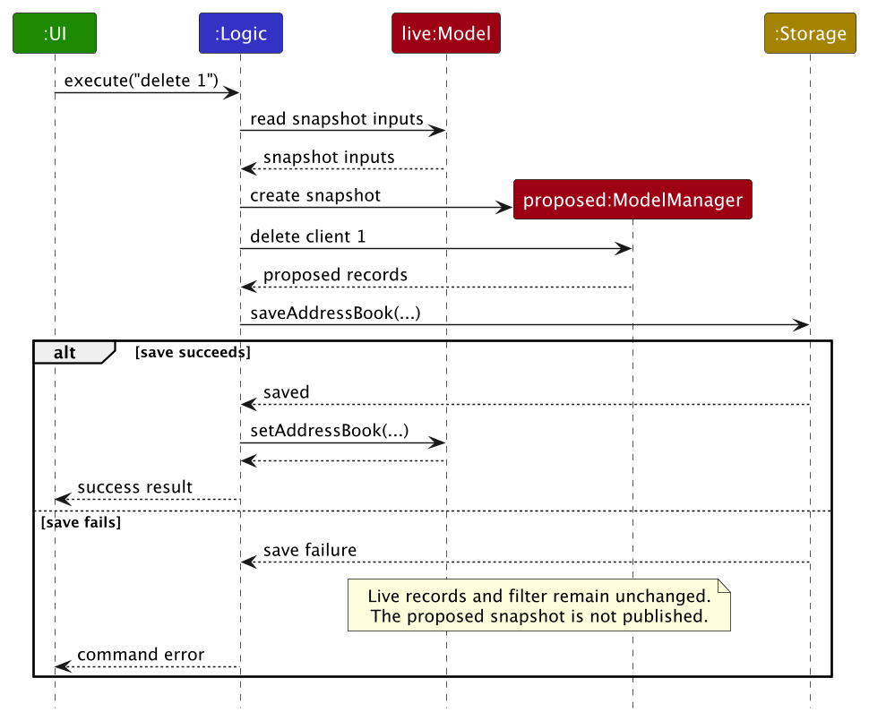

Each of the four main components (also shown in the diagram above),

* defines its *API* in an `interface` with the same name as the Component.
* provides its functionality through a concrete `{Component Name}Manager` class that implements the corresponding API interface.

For example, the `Logic` component defines its API in `Logic.java` and implements it in `LogicManager.java`. Other components interact with a component through its interface rather than its concrete class, preventing them from coupling to that component's implementation, as illustrated in the following partial class diagram.


The sections below give more details of each component.

### UI component

The **API** of this component is specified in [`Ui.java`](https://github.com/AY2627S1-CS2103T-T10-1/tp/blob/master/src/main/java/seedu/address/ui/Ui.java).

The layout follows the original [ClientDesk UI mockup in PR #31](https://github.com/AY2627S1-CS2103T-T10-1/tp/pull/31)
for the implemented client and project workflows. The current workspace uses a light client list beside the selected
client's workspace. The workspace header shows
the client's name and contact summary, with **Projects** and **Details** tabs. Project cards display each project's
title, deadline, status and priority. The bottom command bar remains available for keyboard-based workflows, and Help
is available from the menu and by pressing `F1`. On short screens the brand header collapses to keep the tabs
and command bar visible; Help remains available through the menu, `F1` and the `help` command.

`ClientDetailsPanel` keeps its active tab when the selected client changes. The Details `TextArea` is not editable,
but its text can be selected and copied.
The header abbreviates long name, phone and email values; Details contains the full record. Tags and project cards
have separate scrollable areas so long lists do not hide the tabs.

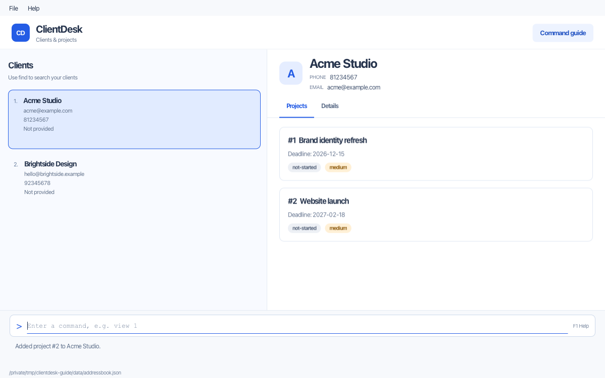

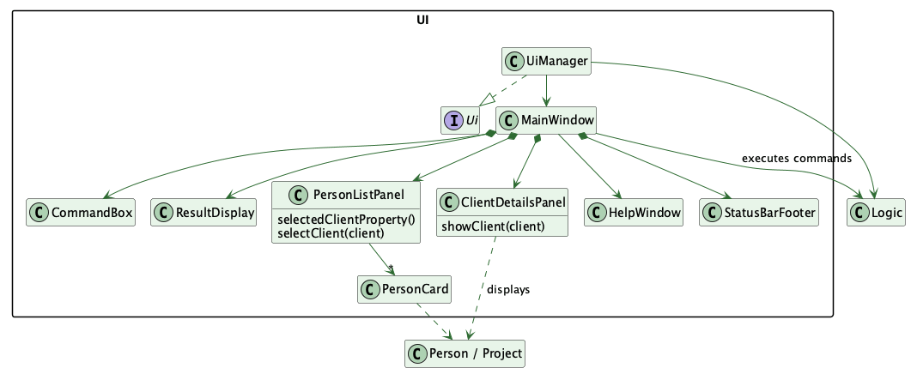

[PlantUML source](diagrams/UiClassDiagram.puml)

The first diagram shows an initialized UI, after `MainWindow.fillInnerParts()`.
`Logic` and `Person` are outside the UI boundary because they belong to the Logic
and Model components respectively.
Filled diamonds indicate composition; solid arrows show navigable associations;
and a dashed line with a hollow triangle shows interface realization. Multiplicities indicate how many target instances may be
associated with each source. Less important UI references are shown as typed
attributes instead of separate class boxes and arrows. `resultDisplay` and `helpWindow` are fields of `MainWindow`. `CommandBox` and
`StatusBarFooter` are omitted from this focused view; they are initialized by
`MainWindow.fillInnerParts()`. Methods and other implementation details
unrelated to selection are omitted. The method parameter shows the details panel's
use of `Person`; a separate dependency arrow is omitted to reduce clutter.

Inheritance is shown separately below to avoid crossing these relationships with
superclass arrows.

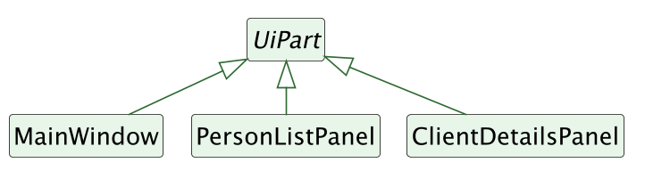

[Inheritance diagram source](diagrams/UiInheritanceDiagram.puml)

The inheritance diagram shows representative subclasses only: `MainWindow`,
`PersonListPanel` and `ClientDetailsPanel`. `CommandBox`, `ResultDisplay`,
`StatusBarFooter`, `HelpWindow` and `PersonCard` also extend `UiPart` but are omitted
from this view. Generic type arguments are omitted. The superclass name is italic
because `UiPart` is abstract; solid lines with hollow triangles point to it.

The UI consists of a `MainWindow` and its parts, such as `CommandBox`, `ResultDisplay`, `PersonListPanel`, `ClientDetailsPanel`, and `StatusBarFooter`. All of these, including `MainWindow`, inherit from the abstract `UiPart` class, which captures common behavior among classes that represent visible GUI parts.

The `UI` component uses the JavaFX UI framework. The layouts of these UI parts are defined in matching `.fxml` files in `src/main/resources/view`. For example, [`MainWindow.fxml`](https://github.com/AY2627S1-CS2103T-T10-1/tp/blob/master/src/main/resources/view/MainWindow.fxml) specifies the layout of [`MainWindow`](https://github.com/AY2627S1-CS2103T-T10-1/tp/blob/master/src/main/java/seedu/address/ui/MainWindow.java).

The `UI` component,

* executes user commands using the `Logic` component.
* listens for changes to `Model` data so that the UI can be updated with the modified data.
* keeps a reference to the `Logic` component, because the `UI` relies on the `Logic` to execute commands.
* depends on some classes in the `Model` component because it displays `Person` objects from the model.

#### Client details selection and refresh

`MainWindow` observes `PersonListPanel.selectedClientProperty()` and passes the selected
`Person` to `ClientDetailsPanel.showClient`. The read-only panel displays contact details
and projects; a null selection shows instructions, and a client with no projects shows
the project empty state.

`view`, Add Client, legacy Add and Edit, Add Project, Edit Project and Delete Project return a `CommandResult` containing
the client to select. For legacy Add/Edit and project mutations, `LogicManager` saves the proposed data before
publishing it to the live model. After successful execution, `MainWindow` calls
`PersonListPanel.selectClient` with the updated client. This restores selection after the
list replacement and refreshes the details without another `view` command. Add and delete
use the same result mechanism as edit; the UI does not parse command text to identify them.

`MainWindow.executeCommand` records the selected client before executing the command.
When a successful command does not request a selection, `MainWindow` restores the previously
selected client's current record by its stored identity if it is still displayed. This keeps
remark and email updates selected without retaining an outdated record. Otherwise, it clears selection.
A `find` that hides the selected client therefore clears selection rather than selecting its first result. If a search
has no matches, `FindCommand` restores the full list and the previous client is restored only if still present.
With no restorable selection, the workspace continues to show its no-client instructions. Deleting a client cannot
select the unrelated client that moves into the deleted row; deleting another client preserves the current selection.

Validation or save failures produce no successful selection result and leave the selected
client and details unchanged. Deleting the selected client clears the selection and returns
the panel to its instructions. The selection is based on the actual updated client, so it
works with filtered lists and multiple clients rather than assuming the first row.

`ClientDetailsUiTest` exercises project refresh, remaining and empty project lists,
invalid commands, failed saves, and selected-client deletion with both full and filtered
lists. `LegacyClientSelectionUiTest` covers legacy add/edit selection after list reorder
and failed-save retention. Focused regression checks are recorded in
[`test/ui-test-plan.md`](https://github.com/AY2627S1-CS2103T-T10-1/tp/blob/master/test/ui-test-plan.md).

### Logic component

**API** : [`Logic.java`](https://github.com/AY2627S1-CS2103T-T10-1/tp/blob/master/src/main/java/seedu/address/logic/Logic.java)

Here's a (partial) class diagram of the `Logic` component:


The sequence diagram below illustrates the interactions within the `Logic` component, taking `execute("delete 1")` API call as an example.


The deletion follows a save-before-publish flow:

1. `AddressBookParser` parses `delete 1` and returns a `DeleteCommand` only after the command syntax is valid.
1. `LogicManager` recognizes `DeleteCommand` as a legacy mutation. It copies the live address book and user preferences into a proposed `ModelManager`, then gives that model the clients currently displayed by the live filter. The index therefore resolves against the same list the user saw.
1. `DeleteCommand` validates the displayed index and deletes the selected client only from the proposed model. The live model and UI have not changed at this point.
1. `LogicManager` asks `Storage` to save the proposed address book. `JsonAddressBookStorage` writes through a temporary file and replaces the existing file only after writing succeeds.
1. If saving succeeds, `LogicManager` publishes the proposed address book with `Model#setAddressBook` and returns the successful `CommandResult`. The live filter remains active and now excludes the deleted client.
1. If saving throws an `IOException`, `LogicManager` converts it to a `CommandException` and does not publish the proposal. The proposed model is discarded, while the live records, displayed filter and existing saved file remain unchanged. A later `list` command only changes the filter and does not save client data, so it cannot persist the rejected deletion.

The same staging boundary protects the inherited `add`, `edit`, `remark` and `clear` mutations. Read-only inherited commands, including `list` and `exit`, execute without saving client data.

All client, project and legacy mutations share `LogicManager#executeStagedMutation`. It prepares a snapshot with the displayed clients, executes the command, saves the result and then publishes it. Small policy helpers preserve command-specific behavior: Add Client and legacy Add/Edit/Remark restore the full list after success; other mutations retain the live filter. Only unchanged Edit Client and Edit Project commands skip saving. Save failures retain their existing command-specific or legacy permission/error messages.

Here are the other classes in `Logic` (omitted from the class diagram above) that are used for parsing a user command:

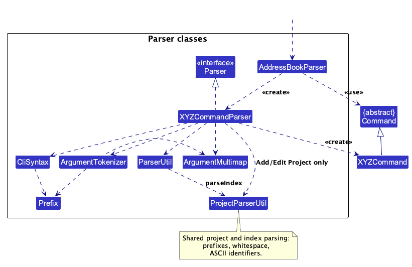

[Command-creation diagram source](diagrams/ParserClasses.puml)

The command-creation diagram uses `XYZCommandParser`/`XYZCommand` as placeholders for representative
prefixed commands, such as legacy Add. `AddressBookParser` creates the appropriate parser; it produces a
command implementing the requested action. `XYZCommandParser` realizes `Parser<T>`, and `XYZCommand`
inherits from the abstract `Command` class.

The argument-parsing relationships are shown separately to keep both diagrams readable.

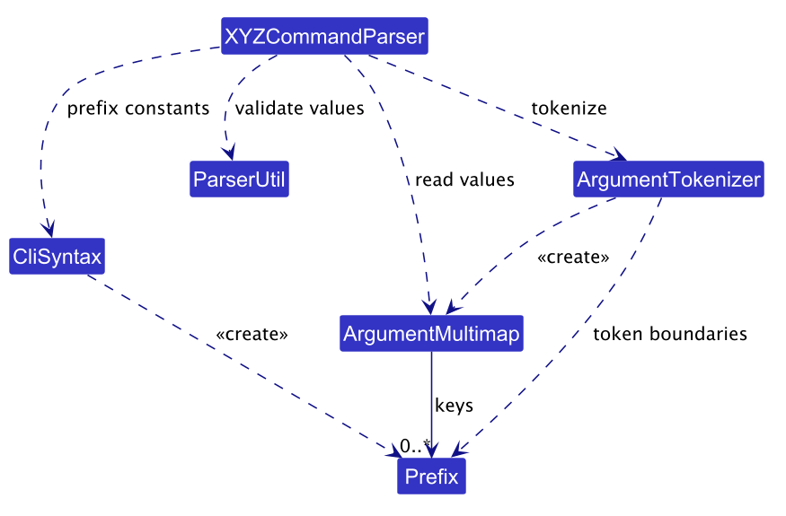

[Tokenization diagram source](diagrams/ParserTokenization.puml)

`CliSyntax` creates the prefix constants. `ArgumentTokenizer` uses prefixes to split input and creates an
`ArgumentMultimap`, whose map stores prefixes as keys. `ParserUtil` validates field values and does not use
`Prefix`. Dashed open-arrow lines show dependencies (with creation labelled); the solid open-arrow line shows
the map's navigable association to its prefix keys. Hollow triangles point to the implemented interface
(dashed line) or superclass (solid line).

Both diagrams are representative subsets, not a claim that every command uses tokenization. Project commands share
`ProjectParserUtil`. Simpler index/keyword parsers, value classes and generic type arguments are omitted for
readability. Individual parsing rules remain in their command sections.

How the parsing works:
* When called upon to parse a user command, the `AddressBookParser` class creates an `XYZCommandParser` (`XYZ` is a placeholder for the specific command name, e.g., `AddCommandParser`). The parser uses the other classes shown above to parse the user command and create an `XYZCommand` object (e.g., `AddCommand`). The `AddressBookParser` returns that object as a `Command` object.
* All `XYZCommandParser` classes, such as `AddCommandParser` and `DeleteCommandParser`, implement the `Parser` interface so they can be treated similarly where appropriate, for example during testing.

### Model component
**API** : [`Model.java`](https://github.com/AY2627S1-CS2103T-T10-1/tp/blob/master/src/main/java/seedu/address/model/Model.java)

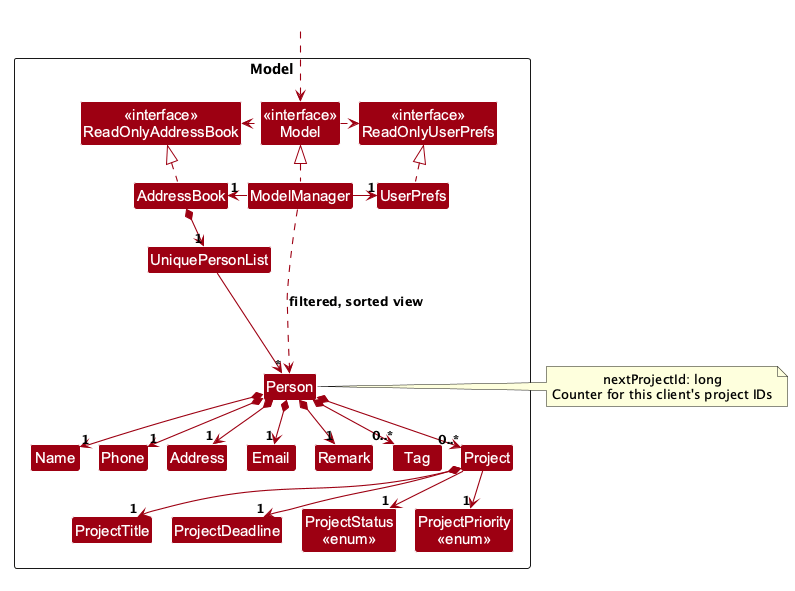


The `Model` component,

* stores the address book data i.e., all `Person` objects (which are contained in a `UniquePersonList` object).
  Each `Person` holds contact fields, a remark and tags, plus an immutable list of projects. A `Project` has a positive
  ID, title, deadline, status and priority. The ID belongs to that client; `Person.nextProjectId` tracks project ID
  allocation and does not decrease when a project is removed.
* stores the `Person` objects selected by the current filter in a `FilteredList`, wrapped in a `SortedList` for display.
  It exposes the displayed list as an unmodifiable `ObservableList<Person>` that both the UI and indexed commands use.
  Changes to the filter, ordering, or underlying records therefore update the same observable view.
* stores a `UserPrefs` object that represents the user’s preferences (currently, just the GUI settings). This is exposed to the outside as a `ReadOnlyUserPrefs` object.
* does not depend on any of the other three components (as the `Model` represents data entities of the domain, they should make sense on their own without depending on other components)

<div markdown="span" class="alert alert-info">:information_source: **Note:** The alternative, arguably more object-oriented, design below keeps a unique list of tags in `AddressBook`, and each `Person` references tags from that list. This lets `AddressBook` maintain one `Tag` object per unique tag instead of each `Person` holding its own `Tag` objects.<br>


</div>


### Storage component

**API** : [`Storage.java`](https://github.com/AY2627S1-CS2103T-T10-1/tp/blob/master/src/main/java/seedu/address/storage/Storage.java)

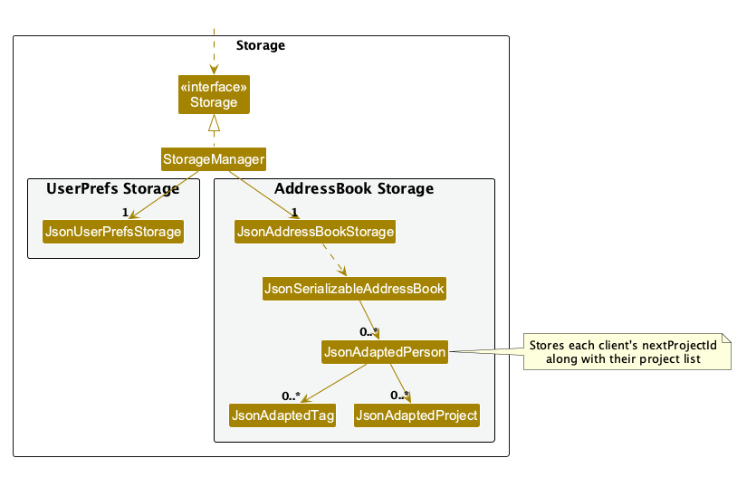

The `Storage` component,
* can save both address book data and user preference data in JSON format, and read them back into corresponding objects.
* is implemented by `StorageManager`, which delegates the actual JSON file access to `JsonAddressBookStorage` and `JsonUserPrefsStorage` (one class per data file).
* uses `JsonSerializableAddressBook` and `JsonAdaptedPerson` to convert clients to and from JSON.
  `JsonAdaptedPerson` stores each client's projects and `nextProjectId`; each project is converted by
  `JsonAdaptedProject`. Legacy client records without those fields load with no projects and the next ID set to 1.
  Stored project fields and IDs are validated before a `Person` is created, so invalid project data is rejected on load.
* depends on some classes in the `Model` component (because the `Storage` component's job is to save/retrieve objects that belong to the `Model`)

`AppPaths.getHome()` returns the containing folder when ClientDesk is launched from a packaged JAR. For an IDE or
class-directory launch, or when the archive location cannot be resolved, it returns the process working directory.
`MainApp` builds the data and preference paths from this home, and each JSON store captures its canonical location
once at startup.
Before each runtime read or save, `AppPaths.resolveWithinHome` resolves the normalized path's existing target or
nearest existing ancestor against that fixed home folder. This rejects outside targets, including links above a
missing data file. Saving also checks the destination's parent before creating temporary files, and the data sidecar
lock before opening it. File logging checks existing rotation, instance and lock filenames
before opening a `FileHandler`; console logging remains available when that check fails. These checks handle existing
links and changes detected between storage operations; they do not claim protection against concurrent filesystem changes.

#### Loading client data

Client data is decoded as strict UTF-8 and must contain exactly one JSON root value, with only JSON whitespace
allowed afterward. The root must contain a `persons` array. Stored clients, tags and projects are checked before
model objects are created: required values must have the expected JSON types and satisfy their model constraints.
Numeric, boolean or structured values are not converted into contact text. Null entries, malformed fields, duplicate
client identities and invalid project records make the entire file fail to load rather than silently dropping records.

Each person requires string fields `name`, `phone`, `email`, `address` and `remark`. A non-null `tags` value must be
an array of strings; an omitted or null `tags` value loads as an empty set. Older files may omit `projects` and `nextProjectId`; these records load with no projects and the next
project ID set to 1. An included project must be an object with a positive integer `id` and string `title`,
`deadline`, `status` and `priority` fields. Those fields are validated against their model constraints, and a client's
counter must be an integer greater than every saved project ID. An omitted counter defaults to 1, so it is valid for
records with no projects; an explicit null or malformed project list or counter is rejected.

For example, this is a valid one-client file with one saved project:

```json
{
  "persons": [
    {
      "name": "Example Studio",
      "phone": "91234567",
      "email": "hello@example.com",
      "address": "Not provided",
      "remark": "",
      "tags": ["web-design"],
      "projects": [
        {"id": 1, "title": "Website", "deadline": "2099-12-31", "status": "not-started", "priority": "medium"}
      ],
      "nextProjectId": 2
    }
  ]
}
```

Tags are JSON strings in the `tags` array; projects are objects, with numeric IDs and string values for their other
fields. Project adapters and `Person` model rules also reject repeated IDs,
duplicate v1.4 title/deadline keys and counters that do not exceed the largest ID.

`MainApp` treats a missing client data file as a first launch and starts with sample clients. If an existing file
cannot be decoded or validated, it records the load failure before constructing `Logic` or the main window. The UI
then displays a recovery alert with the file path and closes after the alert is dismissed. The failed startup does
not rewrite the client file; restore a backup or correct it before restarting.

Startup read logs retain the data-file path and a sanitized diagnostic category (and JSON line/column when available), but omit raw JSON snippets and client field values. Malformed UTF-8 has a fixed diagnostic; model-conversion failures use a generic invalid-stored-values message without nested validation text.

Preferences are nonessential to loading client data. If the preference file is absent or cannot be read, startup
uses default GUI settings and tries to save them. A null GUI-settings value is also replaced with defaults. If that
preference save fails, ClientDesk logs a warning and continues startup; invalid client data instead prevents the
main window from opening.

#### Saving and coordinating instances

Each client-data save creates or opens a sibling `<data-file>.lock` file and attempts a non-blocking exclusive
filesystem lock. The lock file may remain after the application closes and is reused on later saves. If another
process currently holds the lock, the save fails. While holding the lock, storage compares the data file's current
bytes with the snapshot from the last successful read or save. A changed file is treated as stale, and the save
fails; close and reopen ClientDesk to reload the latest file before trying again. Some commands show a general
save-failure message rather than the underlying stale-data cause.

Snapshots are tracked per normalized data-file path. A direct storage API caller that saves a path before reading it
has no baseline and retains the first-save behavior without a stale-content comparison. Normal application startup
reads the active path first, including recording a missing-file snapshot, so later user commands have a baseline.

For a current snapshot, storage writes JSON to a temporary file beside the data file and requests an atomic replace
of the destination. If the filesystem cannot perform that atomic move, the save fails; there is no non-atomic move
fallback. `LogicManager` publishes the staged model only after storage reports success. Rejected stale or locked
saves leave both the live data and saved file unchanged; other save failures do not publish the proposed records.
The displayed filter and selection follow the command's existing behavior.

`FileUtil` also uses a strict UTF-8 encoder when writing text. A malformed surrogate in an accepted free-text field
causes an encoding error instead of silently replacing characters. Serialization/encoding failure occurs before
replacing the destination, so the original saved data remains intact and the staged model is not published.

### Common classes

Classes used by multiple components are in the `seedu.address.commons` package.

--------------------------------------------------------------------------------------------------------------------

## **Implementation**

This section describes some noteworthy details on how certain features are implemented.

### Help

`ClientDeskHelp` stores the supported ClientDesk client and project command instructions in an ordered,
unmodifiable map. It supplies the overview and detailed instructions to `HelpCommand`. Each entry describes
an implemented command; planned commands have no entry. Every command routed by `AddressBookParser` has an
entry, including the legacy `add`, `edit`, `delete`, `clear` and `exit` commands. Legacy field rules are shared
between the Add and Edit entries; they intentionally differ from Add Client's phone and tag creation rules.
`HelpIntegrationTest` executes the catalogue examples with disposable JSON storage and checks Help against
unwritable storage without changing data or the displayed filter.

`HelpCommandParser` accepts zero or one command name and matches names case-insensitively. An unknown name
produces an error; multiple names produce `Usage: help [COMMAND]`. `HelpCommand` returns a result that opens
`HelpWindow`, whose scrollable text displays the instructions. The Help menu and `F1` open the overview.
`LogicManager` skips saving for Help, so viewing instructions preserves client data and the displayed filter.

The sequence below traces `help remark` from the command box to the Help window. The reference frame summarizes parsing by `AddressBookParser` and `HelpCommandParser` to keep the focus on the catalogue lookup and display flow. Result-display updates, logging and window layout details are omitted.

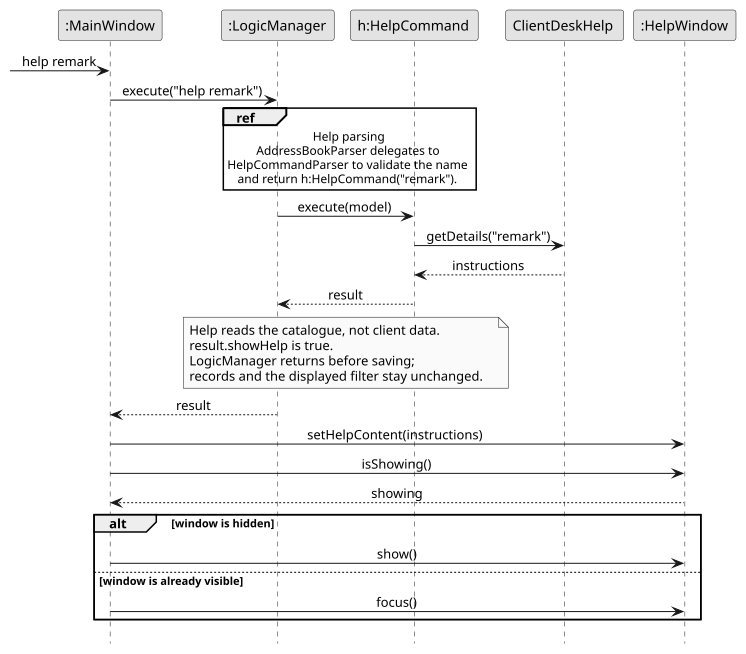

The parser checks the requested name against `ClientDeskHelp` before creating a `HelpCommand`. Executing that command reads the instructions and returns a `CommandResult` with `showHelp` set to `true`; it does not execute `RemarkCommand` or access client records. `LogicManager` returns this result before its save path. `MainWindow` uses the result's instructions to update `HelpWindow`, then shows or focuses the window. This separation keeps Help usable when client-data saving is unavailable and preserves the displayed filter.

With no command name, `help` returns the catalogue overview instead. The Help menu and `F1` call `MainWindow.handleHelp()` directly with the same overview, bypassing command parsing and storage. An unknown name or more than one argument causes a `ParseException` before a Help command is created; the command box displays the error and the Help window's content is unchanged. The existing Help parser, integration and UI tests cover these paths.

### Add client

`ParserUtil.parseEmail` rejects Unicode whitespace and separator characters in new command input, including `edit-client`. The stored `Email` representation retains its existing validation so records accepted by v1.4 still load and round-trip unchanged. `EmailInputIntegrationTest` checks all four email-entry commands and legacy storage compatibility.


`AddClientCommandParser` requires name, phone and email, accepts repeated tags, and rejects repeated required
prefixes or unknown single-character prefixes. It validates the creation rules before building a `Person`. Phone
formatting, including parentheses around nonempty digit groups, is removed and tags are lowercase. Empty, nested
or unmatched parentheses and separators inside a group are rejected. The new client has the address `Not provided`,
no projects and next project ID 1.

The shared `Name` validator accepts Unicode letters, marks and numbers plus the documented punctuation, with
at least one letter or number. Its 1–80 limit counts code points, including each combining mark. `ParserUtil`
applies this rule to `add-client`, legacy `add` and legacy `edit`; JSON loading uses the same validator. Spelling
is preserved without Unicode normalization, including decomposed accents. The character whitelist continues to
reject control characters, format characters and unpaired surrogates; it does not enforce mark placement.
Slashes are allowed. Add Client's prefix scanner reserves single-character markers but exempts standalone `S/O`
and `D/O` (case-insensitive), preserving relationship notation and business names such as `Acme Design/Consulting`.
Known whitespace-separated prefixes still delimit fields; legacy Add/Edit retain their existing tokenization.

`AddClientCommand` checks duplicates against all stored clients, including clients hidden by the current filter.
A duplicate has the same email ignoring case, or the same normalized name and phone. A matching name alone
does not prevent creation. `Person.hasSameClientIdentity()` combines the v1.4 identity comparison with Unicode `equalsIgnoreCase()` on whitespace-normalized, NFC-normalized names. Both add commands use it against the full stored list; inherited `edit` rejects new collisions, including hidden clients. Canonically equivalent spellings such as `José` and `José` compare alike without removing accents or changing displayed text.

`Person.isSamePerson()` and the stored-list invariant retain v1.4 semantics so formerly accepted Unicode case and NFC/NFD pairs can load, be staged and round-trip without losing records. Unrelated edits may preserve an existing collision; edits that introduce a new collision or violate the original identity rule are rejected before mutation. `ClientDuplicateIntegrationTest` covers new-add/edit rejection and existing-pair persistence with remarks and projects.

`LogicManager` runs Add Client on a staged model and saves that model before publishing it to the live model.
If saving fails, the live data and displayed filter stay unchanged. A successful save publishes the new client,
restores the full list and selects the new entry. Copying the existing address book into the staged model retains
each existing client's projects and next project ID.

### Editing a client's email safely

`LogicManager` executes `edit-client` against a proposed model carrying the currently displayed clients. An unchanged email skips saving. Otherwise, storage must succeed before the proposed records replace the live records. This preserves the live filter, selection and details when saving fails; successful publication re-evaluates the existing filter against the new email.

`EditClientUiTest` covers a selected client found by their old email. Its failing storage stub verifies that a rejected email change cannot clear the selection or details.

### Find clients

`FindCommandParser` splits the input into keywords and rejects empty input or keywords longer than 50 Unicode
code points with `Usage: find KEYWORD [KEYWORD]...`. Validation happens before changing the displayed list.

`PersonContainsKeywordsPredicate` copies the original keywords, normalizes a search copy to NFC, and compiles each as a `Pattern` with
`LITERAL | CASE_INSENSITIVE | UNICODE_CASE`. `Matcher.find()` applies locale-independent Unicode case matching to
substrings, including Turkish I variants, Greek sigma variants and supplementary letters. Literal patterns preserve
punctuation; matching does not remove accents or expand `ß` to `ss` (but `ß` and `ẞ` match each other).
Every keyword must match a field of the same client. Name, email and tag matching uses literal substrings; phone
matching also accepts phone-like keywords after removing a leading plus, formatting spaces, hyphens and valid
parentheses around digit groups. Malformed parentheses do not match phone digits. Keywords
may match different fields. Separate field, phone, tag and substring helpers keep matching at one level of abstraction.

`ModelManager` wraps its `FilteredList` in a `SortedList`, ordered case-insensitively by name and then by the client's
position in the stored address book. Sorting leaves stored records in creation order. The UI and indexed commands
share this displayed list, so editing or deleting index 1 always targets the first visible client.

`FindCommand` displays `Found <number> matching clients.` when matches exist. Otherwise, it restores the full list
and displays `No clients matched: <keywords>.`, preserving keyword case and joining keywords with single spaces.
Each search considers the full address book. `LogicManager` skips saving for `FindCommand` because search only
changes the view. `HelpCommand` also skips saving because it only displays instructions.
Other commands keep their existing saving behavior.

### Add project

`AddProjectCommandParser` creates `AddProjectCommand` from a displayed client index and validated project fields.
The title and deadline are required; status defaults to `NOT_STARTED` and priority defaults to `MEDIUM`.
`ProjectStatus` represents the finite progress states; creation rejects `COMPLETED` while storage accepts it for
future project editing. `ProjectPriority` represents the three priority levels.

#### Validation and identity

`ProjectTitle` counts Unicode code points, rejects control/format characters and unpaired surrogates, and requires
a letter or number. Its display value retains internal spacing. `ProjectTitle.isSameTitle` collapses Unicode spaces
and matches either the existing `Locale.ROOT` lowercase key or an NFC-normalized `String.equalsIgnoreCase`
comparison. This covers canonically equivalent spellings and Unicode case variants such as dotless I, final sigma
and supplementary letters without expanding `ß` to `ss`.
`ProjectDeadline` accepts only an ASCII, strict ISO calendar date in
years 0001–9999; impossible dates are not normalized into another day.

The parser recognizes known prefixes at whitespace boundaries, allowing parameter reordering and literal slash
text such as `UI/UX` in titles. Known parameter prefixes are reserved delimiters. It rejects repeated prefixes,
invalid or overflowing indexes and invalid scalar values. `AddressBookParser` retains raw arguments for
`add-project` so its outer trimming cannot hide a trailing title control character.

Each immutable `Person` owns an immutable list of `Project` values and a persisted `nextProjectId`. The constructor
checks unique positive IDs, unique v1.4 normalized title/deadline pairs and a counter greater than every saved ID.
New command operations additionally reject canonical NFC-equivalent title/deadline pairs; previously loadable pairs
retain their saved spelling and remain available for status/priority edits and deletion.
IDs are independent between clients. The counter can reach `Integer.MAX_VALUE + 1L` as an exhausted sentinel;
the command then reports exhaustion instead of overflowing. Deleting a project retains the counter, so a deleted
ID is never reused. Existing client edit and remark commands preserve both fields.

#### Saving a project

1. `LogicManager` copies the live address book into a proposed `ModelManager`.
2. It limits the proposed displayed list to the currently visible clients. The shared name/creation-order comparator
   keeps their indexes aligned with the live sorted list.
3. `AddProjectCommand` checks the target and duplicate key, proposes the next ID, and replaces the immutable client
   in the proposed model. It uses a `Clock` to determine whether to append the overdue warning.
4. `JsonAddressBookStorage` serializes the proposed data to a temporary file and atomically replaces the destination.
5. Only after the save succeeds does `LogicManager` publish the proposed address book and return success.
   The live search predicate is retained; project fields do not change client-search matching.

An `IOException` produces the project save-failure message without publishing data, list changes or ID allocation.
Immutable values prevent the proposed transaction from mutating the live snapshot.

#### Deleting a project

`DeleteProjectCommandParser` accepts a displayed client index and a positive project ID. The command resolves the
index against the current displayed list, then searches only that client's projects. It creates a replacement
client with the selected project removed and the existing `nextProjectId` retained. `LogicManager` performs this
operation in a proposed model, saves the proposed address book, and publishes it only after storage succeeds.
An invalid index, unknown client-scoped ID or failed save leaves the live model and its filter unchanged.

#### Persistence and compatibility

`JsonAdaptedProject` validates the original JSON token types before constructing model values. Numeric strings,
fractional IDs, invalid enums, impossible dates and missing/null project fields fail loading. `JsonAdaptedPerson`
rejects malformed project collections, duplicate IDs, duplicate v1.4 keys and stale counters. Omitted project fields remain valid
for legacy files, with no projects and a next ID of 1. Nonempty project data must include its saved counter. Serialization
writes both `projects` and `nextProjectId` for all clients. Project lists and counters must be retained by any future
client-copy operation, including undo snapshots.

Storage retains v1.4's `ProjectTitle.normalizedValue()` validation key so previously accepted Unicode title pairs,
including canonical NFC/NFD variants, remain readable and survive saving without changing their spelling, IDs or counter.
New additions and title/deadline edits use the broader duplicate matching above. Status/priority edits and deletion
remain available for existing pairs; duplicate IDs and pairs already invalid under v1.4 still fail loading.

This subsection describes project creation and deletion. Project editing is described in the Edit project
subsection below. Undo, notes, follow-ups and agenda are planned.

#### Test coverage

The project unit tests check title/date boundaries, locale-independent identity, enums, immutable lists and ID
exhaustion. Parser tests cover shuffled/case-insensitive prefixes, defaults, duplicate fields, literal slash text,
control characters, invalid dates and index overflow. Storage tests exercise legacy files, round trips, malformed
JSON token types, duplicate project data and retired IDs.

`AddProjectCommandIntegrationTest` exercises the real parser/logic/storage path, including filtered indexes,
restart allocation, failed saves with unchanged file bytes and no live-list events, retry and
existing client edits/deletion. `AddProjectUiTest` enters commands through the JavaFX command box and verifies
feedback, retained filtering, saved project data and duplicate errors.

`DeleteProjectCommandIntegrationTest` verifies displayed indexes, client-scoped IDs, persisted deletion without
counter reuse, unchanged file bytes and live-list events on save failure, retry, and preservation through client
editing and `list-clients`. Command and parser tests cover successful deletion, invalid indexes and IDs, and
argument validation.
### Edit project

`EditProjectCommandParser` reads a displayed client index and stable, client-local project ID. It rejects repeated prefixes and invalid identifiers/field values and creates an immutable `EditProjectDescriptor` containing only supplied fields. `ProjectTitle` and `ProjectDeadline` centralize title/date validation; `ProjectStatus` and `ProjectPriority` provide the persisted command vocabulary. The descriptor can represent completion, reopening, and any combination of title/deadline/priority changes. Add and Edit Project use `ProjectParserUtil` for case-insensitive prefix scanning and whitespace trimming. Command-specific field requirements and validation remain in their respective parsers. Known prefixes delimit fields; other slash-containing title words remain literal text. Boundary trimming uses linear scans so oversized inputs with long internal space runs are rejected promptly.

`EditProjectCommand` finds the client in the displayed list and the project by ID within that client. It applies the descriptor without changing the ID or other projects, and checks for conflicting work under that client when the title or deadline changes. An exact no-op returns without mutation. Both failed lookup and duplicate validation happen before updating the proposed client.

`LogicManager` executes this command against a staged `ModelManager` copied from the live data. The staging filter contains exactly the clients visible when the command was submitted, so the displayed index resolves consistently even after a search. Only after `Storage.saveAddressBook` succeeds does it publish the staged data to the live model; the live filter itself is retained. A save failure leaves the live model, filter and persisted data unchanged. `JsonAddressBookStorage` already uses atomic file replacement, which protects the original saved file during write failures.

The class diagram shows the command's dependencies and its immutable descriptor. `EditProjectDescriptor` is a nested Java record; its nullable fields represent omitted updates. Only relationships relevant to editing are shown.

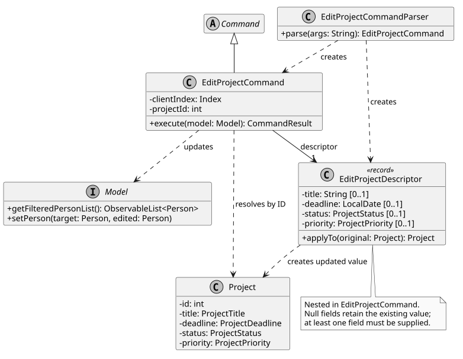

The sequence below starts after parsing a valid edit that changes data. `LogicManager` prepares the proposed model and its displayed-client filter before executing the command. Lookup, duplicate and no-op paths are omitted for readability; they return or throw before saving.

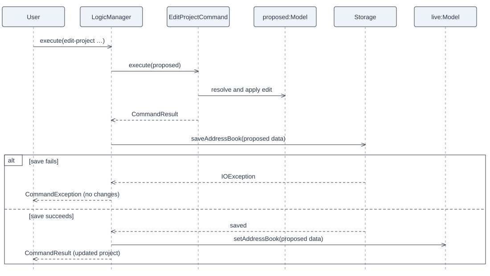

* **Model:** `Person` owns an immutable list of immutable `Project` values, each with `id`, `title`, `deadline`, `status` and `priority`. IDs must be positive and unique within each client. Equality includes project data so snapshots and no-op checks detect edits correctly. `withProjects` copies the contact details, remark and tags and retains the per-client `nextProjectId` allocation counter during an edit. Existing contact and remark edits preserve project lists.
* **Storage:** `JsonAdaptedProject` validates all five stored fields through the same domain rules as parsing. `JsonAdaptedPerson` reads an absent `projects` field as an empty list for legacy compatibility and requires a persisted `nextProjectId` for nonempty project lists; legacy clients without projects default to ID 1. Explicit null project lists, invalid fields/counters, duplicate IDs, duplicate v1.4 title/deadline keys and null list entries fail through `IllegalValueException`/`DataLoadingException`. `view` includes project IDs and current values so users can identify the edit target.
* **Design choice:** staging avoids showing an unsaved change or depending on a rollback after failure. It copies the client collection for each edit, trading modest allocation for a clear failure contract. Immutable values make shallow snapshots safe. Project ID allocation and project creation belong to Add Project, not this command. Editing never consumes an ID.
* **Shared project support:** Edit Project uses the project values, client collection/counter and JSON schema introduced by Add Project. The edit command preserves `nextProjectId`; it neither allocates a project ID nor creates a project.

This feature implements user stories **16** (status and completion), **25** (updating priority) and **33** (title/deadline changes). UC04 describes its complete interaction; the manual-testing appendix covers its acceptance and failure cases.

Automated tests cover partial/full edits, filtered client indexes, client-local non-consecutive IDs, completion/reopening, duplicates, invalid input, no-op saves, persistence/reload, save/permission failures, legacy JSON, invalid stored data, immutability and preservation through existing client edits. `AddEditProjectIntegrationTest` exercises Add → Edit → Restart → Add → Reopen with stable IDs and duplicate-update rejection. `EditProjectUiTest` submits commands through the JavaFX command box and checks edited-client selection, feedback, filter retention, project display, persistence and invalid-priority rejection.

### \[Proposed\] Undo/redo feature

#### Proposed Implementation

The proposed undo/redo mechanism is facilitated by `VersionedAddressBook`. It extends `AddressBook` with an undo/redo history, stored internally as an `addressBookStateList` and `currentStatePointer`. Additionally, it implements the following operations:

* `VersionedAddressBook#commit()` — Saves the current address book state in its history.
* `VersionedAddressBook#undo()` — Restores the previous address book state from its history.
* `VersionedAddressBook#redo()` — Restores a previously undone address book state from its history.

These operations are exposed in the `Model` interface as `Model#commitAddressBook()`, `Model#undoAddressBook()` and `Model#redoAddressBook()` respectively.

Given below is an example usage scenario and how the undo/redo mechanism behaves at each step.

Step 1. The user launches the application for the first time. The `VersionedAddressBook` will be initialized with the initial address book state, and the `currentStatePointer` pointing to that single address book state.


Step 2. The user executes `delete 5` command to delete the 5th person in the address book. The `delete` command calls `Model#commitAddressBook()`, causing the modified state of the address book after the `delete 5` command executes to be saved in the `addressBookStateList`, and the `currentStatePointer` is shifted to the newly inserted address book state.


Step 3. The user executes `add n/David …​` to add a new person. The `add` command also calls `Model#commitAddressBook()`, causing another modified address book state to be saved into the `addressBookStateList`.


<div markdown="span" class="alert alert-info">:information_source: **Note:** If a command fails its execution, it will not call `Model#commitAddressBook()`, so the address book state will not be saved into the `addressBookStateList`.

</div>

Step 4. The user now decides that adding the person was a mistake, and decides to undo that action by executing the `undo` command. The `undo` command will call `Model#undoAddressBook()`, which will shift the `currentStatePointer` once to the left, pointing it to the previous address book state, and restores the address book to that state.


<div markdown="span" class="alert alert-info">:information_source: **Note:** If the `currentStatePointer` is at index 0, pointing to the initial AddressBook state, then there are no previous AddressBook states to restore. The `undo` command uses `Model#canUndoAddressBook()` to check if this is the case. If so, it will return an error to the user rather
than attempting to perform the undo.

</div>

The following sequence diagram shows how an undo operation goes through the `Logic` component:


<div markdown="span" class="alert alert-info">:information_source: **Note:** The lifeline for `UndoCommand` should end at the destroy marker (X), but due to a limitation of PlantUML, it continues to the end of the diagram.

</div>

Similarly, how an undo operation goes through the `Model` component is shown below:


The `redo` command does the opposite — it calls `Model#redoAddressBook()`, which shifts the `currentStatePointer` once to the right, pointing to the previously undone state, and restores the address book to that state.

<div markdown="span" class="alert alert-info">:information_source: **Note:** If the `currentStatePointer` is at index `addressBookStateList.size() - 1`, pointing to the latest address book state, then there are no undone AddressBook states to restore. The `redo` command uses `Model#canRedoAddressBook()` to check if this is the case. If so, it will return an error to the user rather than attempting to perform the redo.

</div>

Step 5. The user then decides to execute the command `list`. Commands that do not modify the address book, such as `list`, will usually not call `Model#commitAddressBook()`, `Model#undoAddressBook()` or `Model#redoAddressBook()`. Thus, the `addressBookStateList` remains unchanged.


Step 6. The user executes `clear`, which calls `Model#commitAddressBook()`. Since the `currentStatePointer` is not pointing at the end of the `addressBookStateList`, all address book states after the `currentStatePointer` will be purged. Reason: It no longer makes sense to redo the `add n/David …​` command. This is the behavior that most modern desktop applications follow.


The following activity diagram summarizes what happens when a user executes a new command:


#### Design considerations:

**Aspect: How undo & redo execute:**

* **Alternative 1 (proposed choice):** Saves the entire address book.
  * Pros: Easy to implement.
  * Cons: May have performance issues in terms of memory usage.

* **Alternative 2:** Individual command knows how to undo/redo by
  itself.
  * Pros: Will use less memory (e.g. for `delete`, just save the person being deleted).
  * Cons: We must ensure that the implementation of each individual command is correct.

### \[Proposed\] Data archiving

Archiving and restoring clients are future requirements. The current application has no archive command or
archive flag in its data model. An archival design has not been implemented; deleting a client permanently removes
its record and associated projects. To retain a copy of current records, use the backup procedure in the
[User Guide](UserGuide.md#editing-the-data-file).


--------------------------------------------------------------------------------------------------------------------

## **Documentation, logging, testing, dev-ops**

* [Documentation guide](Documentation.md)
* [Testing guide](Testing.md)
* [Logging guide](Logging.md)
* [DevOps guide](DevOps.md)

--------------------------------------------------------------------------------------------------------------------

## **Appendix: Requirements**

### Product scope

**Target user profile**:

* is a freelancer or independent professional managing client relationships
* needs to organize client details, projects, deadlines and follow-ups
* prefers a desktop app with local data storage
* can type fast and prefers typed commands to mouse interactions

**Value proposition**: Keep client details and related work in one place, using typed commands to find and update records.


### User stories

The stories below describe the needs of freelancers and independent professionals using ClientDesk.
They include requirements considered for later versions; inclusion here does not mean a feature has been implemented.

Priorities: High (must have) - `* * *`, Medium (nice to have) - `* *`, Low (unlikely to have) - `*`.
High-priority stories support the core workflows in the agreed MVP feature specification.
Medium- and low-priority stories record optional enhancements and deferred requirements.

Priority expresses the original need, not release status. The current release implements client creation/deletion,
contact and tag editing, clearing all records, one replaceable client remark, search/list/view, project creation/editing/deletion, Help and local
persistence. Separate client/project notes, dated follow-ups, agenda views, undo/redo, archiving, custom sorting and
dashboard/export commands are **future requirements**, including where they have high priority below. A remark is
not a dated follow-up or a history of notes. Projects are displayed in ID order, not deadline order.

IDs 1-30 refer to the original requirements list. Overlapping stories are combined while retaining their IDs.
IDs 31-36 capture needs made explicit by the feature specification and usage narrative.

| ID | Priority | As a ... | I want to ... | So that I can ... |
| --- | --- | --- | --- | --- |
| 1 | `* * *` | freelancer with several ongoing projects | view pending projects in deadline order | decide which work needs my attention first |
| 2 | `* * *` | freelancer | add a client with their contact details | keep a record of the people and businesses I work with |
| 3 | `* *` | freelancer seeking repeat business | identify inactive clients whose projects have ended | contact them about new opportunities |
| 4, 27, 28, 29 | `* * *` | freelancer | edit a client's name, phone number or email address | keep their contact information accurate |
| 5 | `*` | freelancer working with several people at one organization | associate multiple contact people with one client record | keep related contacts together |
| 6 | `* * *` | freelancer | record notes about a client | remember information from previous interactions |
| 7 | `* *` | freelancer with many clients | choose to sort clients by name, follow-up date or date added | browse records in the order useful to me |
| 8, 12 | `* * *` | freelancer working across industries and project types | add or remove client tags | keep the categories of my professional relationships accurate |
| 9 | `* *` | freelancer | export my client records | keep a backup or use the information outside ClientDesk |
| 10 | `* * *` | freelancer | delete a client record I no longer need | remove unwanted records from my client list |
| 11 | `* * *` | freelancer | find clients using partial names, phone numbers, email addresses or tags | retrieve a client's information without scanning the whole list |
| 13 | `* * *` | freelancer | set or update a client's follow-up date and details | remember when and why to contact them |
| 14 | `* *` | freelancer | archive inactive clients and restore them when needed | focus on active relationships while retaining access to old records |
| 15 | `* * *` | freelancer | record notes about a client's ongoing project | retain the requirements and decisions relevant to that work |
| 16 | `* * *` | freelancer | update a project's status, including marking it completed | distinguish work still in progress from finished work |
| 17 | `* *` | freelancer | receive an alert when a client follow-up is due | notice important actions without repeatedly checking the agenda |
| 18 | `* *` | freelancer reviewing several clients | compare the details of multiple clients at once | review related records without repeatedly switching between them |
| 19 | `* * *` | freelancer | view a client's contact details, tags, projects, notes and follow-up | recover the context needed to work with or contact that client |
| 20 | `* * *` | freelancer | identify overdue follow-ups and the clients they belong to | contact clients whose follow-ups I have missed |
| 21 | `*` | freelancer using client tags | distinguish tags by colour | recognize client categories at a glance |
| 22 | `* * *` | freelancer who made an accidental change | undo my most recent data-changing action | recover the previous records without re-entering them |
| 23 | `* *` | freelancer | view a summary of my clients and pending work | understand my current business workload |
| 24 | `*` | freelancer seeking new clients | receive prospective clients' enquiries through ClientDesk | keep incoming leads together with my client records |
| 25 | `* * *` | freelancer with competing commitments | set or update a project's priority | identify work that matters most when deadlines alone are insufficient |
| 26 | `* * *` | freelancer | add a project with a deadline under its client | track that client's deliverables and when they are due |
| 30 | `* *` | freelancer | view a summary of completed projects | review my past work and output |
| 31 | `* * *` | new or returning user | view command descriptions, formats and examples | learn or recall how to use ClientDesk |
| 32 | `* * *` | freelancer | list my clients in name order with their contact details and tags | browse my records and choose the client I need to work with |
| 33 | `* * *` | freelancer | edit a project's title or deadline | keep the recorded work accurate when plans change |
| 34 | `* * *` | freelancer planning upcoming work | view upcoming projects and client follow-ups together in an agenda | plan my work and client communications in one place |
| 35 | `* * *` | freelancer returning to ClientDesk | retrieve the records saved during my previous session | continue managing clients without re-entering their information |
| 36 | `* *` | freelancer with many clients | filter clients by tags or by whether they have pending or overdue work | focus on the relationships relevant to my current task |

### Use cases

(For all use cases below, the **System** is `ClientDesk` and the **Actor** is a freelancer or independent
professional, unless specified otherwise.)

#### UC01: Record new work for a client

**Preconditions:** ClientDesk is running and the client has already been added.

**Current workflow (available in v1.6)**

1.  User searches for the client by name.
2.  ClientDesk shows the matching client.
3.  User views the client's details.
4.  User adds a project with a title and deadline to the client.
5.  ClientDesk validates and saves the project.

**Planned continuation (Coming soon; unavailable in v1.6)**

6.  User adds a note describing the latest client interaction.
7.  ClientDesk validates and saves the note.
8.  User sets a follow-up date and optional follow-up details for the client.
9.  ClientDesk validates and saves the follow-up.
10. User opens the agenda.
11. ClientDesk shows the project and follow-up in date order.

    Use case ends.

**Extensions**

* 2a. No client matches the search.

  * 2a1. ClientDesk informs the user that no clients matched and restores the full client list.
  * 2a2. User adds the client using their name, phone number and email address.
  * 2a3. ClientDesk validates and saves the new client.

    Use case resumes at step 3.

* 3a. The selected client index is invalid.

  * 3a1. ClientDesk informs the user that there is no client at that index.

    Use case resumes at step 1.

* 5a. The project details are invalid or duplicate an existing project for the client.

  * 5a1. ClientDesk shows the relevant error and does not create the project.

    Use case resumes at step 4.

* 7a. [Coming soon] The note is invalid or cannot be saved.

  * 7a1. ClientDesk shows the relevant error and does not add the note.

    Use case resumes at step 6.

* 9a. [Coming soon] The follow-up date or details are invalid, or the follow-up cannot be saved.

  * 9a1. ClientDesk shows the relevant error and retains the previous follow-up.

    Use case resumes at step 8.

#### UC02: Resolve overdue work (Coming soon)

**Preconditions:** At least one client has an overdue project or follow-up in ClientDesk.

This end-to-end agenda and follow-up workflow is planned and is not available in v1.6. The current release lets users
view a client's project values, edit a project's status and other values, and see an overdue warning when adding a
project with a past deadline. It does not yet provide agenda, note or dated follow-up operations.

**Planned MSS**

1.  User requests to view overdue agenda items.
2.  ClientDesk shows all pending projects and follow-ups dated before today.
3.  User selects an overdue client's record.
4.  ClientDesk shows the client's projects, recent notes, tags and follow-up details.
5.  User replaces the client's follow-up with a new date and optional details.
6.  ClientDesk validates and saves the new follow-up.
7.  User marks the overdue project as completed.
8.  ClientDesk validates and saves the updated project.
9.  User requests to view overdue agenda items again.
10. ClientDesk no longer shows the completed project or rescheduled follow-up as overdue.

    Use case ends.

**Extensions**

* 2a. There are no overdue projects or follow-ups.

  * 2a1. ClientDesk informs the user that there are no pending items in the period.

    Use case ends.

* 3a. The selected client index is invalid.

  * 3a1. ClientDesk informs the user that there is no client at that index.

    Use case resumes at step 2.

* 6a. The follow-up date or details are invalid, or the follow-up cannot be saved.

  * 6a1. ClientDesk shows the relevant error and retains the previous follow-up.

    Use case resumes at step 5.

* 8a. The project ID or updated status is invalid, or the project cannot be saved.

  * 8a1. ClientDesk shows the relevant error and retains all previous project values.

    Use case resumes at step 7.

#### UC03: Delete a client permanently

**Preconditions:** At least one client exists.

**MSS**

1.  User lists all clients.
2.  ClientDesk shows the clients with their current indexes.
3.  User deletes a client by index.
4.  ClientDesk saves the deletion of the client and all associated projects, remarks and tags.
5.  ClientDesk confirms that the client was deleted.

    Use case ends.

**Extensions**

* 3a. The selected client index is invalid.

  * 3a1. ClientDesk informs the user that there is no client at that index.

    Use case resumes at step 2.

* 4a. ClientDesk cannot save the deletion.

  * 4a1. ClientDesk informs the user that the client could not be deleted and makes no changes.

    Use case resumes at step 3.

#### UC04: Update an existing project

**Preconditions:** The client and project are already stored in ClientDesk.

**MSS**

1. User requests the client's details.
1. ClientDesk shows the client's projects and their IDs.
1. User identifies a project and supplies changes to its title, deadline, status or priority.
1. ClientDesk validates and saves the changes.
1. ClientDesk confirms the updated project details.

   Use case ends.

**Extensions**

* 1a. The client cannot be found in the displayed list.

  * 1a1. ClientDesk informs the user that the selected client is invalid.

    Use case resumes at step 1.

* 3a. The specified client or project does not exist.

  * 3a1. ClientDesk reports the missing target and makes no changes.

    Use case resumes at step 1.

* 3b. No field is supplied, or the supplied changes are invalid.

  * 3b1. ClientDesk explains the input error and makes no changes.

    Use case resumes at step 3.

* 4a. The changes duplicate another project's normalized title and deadline under this client.

  * 4a1. ClientDesk reports the conflict and makes no changes.

    Use case resumes at step 3.

* 4b. All supplied values already match the stored project.

  * 4b1. ClientDesk reports that no changes are needed and does not save.

    Use case ends.

* 4c. ClientDesk cannot save the changes.

  * 4c1. ClientDesk reports the save failure and retains the previous live and saved data.

    Use case resumes at step 3.

### Non-Functional Requirements

These are product targets for the requirements above, including future features. References to notes, follow-ups
and agenda do not imply current support. The current build and CI target Java 25; later Java releases are not
guaranteed by those checks.

1.  ClientDesk should work on any _mainstream OS_ with Java `25` or above installed.
2.  ClientDesk should support at least 1000 clients and their associated projects, notes, tags and follow-ups without
    data loss.
3.  ClientDesk should respond to `list`, `find`, `view` and `agenda` commands within 1 second under typical usage with
    1000 clients stored.
4.  All client, project, note, follow-up and agenda workflows should be completable using only the keyboard.
5.  A new user who is familiar with command-line applications should be able to complete the feature list's
    end-to-end acceptance scenarios within 15 minutes by referring to the User Guide.
6.  ClientDesk should save each successful data-changing command before displaying its success message and should
    preserve the saved data after a normal shutdown and restart.
7.  A failed save or invalid command should not cause a partial update or modify previously saved data.
8.  An invalid search or invalid details index should retain the previously displayed information instead of
    leaving the user with an empty or unusable view. A valid search with zero matches intentionally restores the
    full client list. Future agenda-computation failures should likewise leave the previous usable view available.

### Glossary

* **Agenda (future)**: A chronological view that brings together upcoming and overdue project deadlines and follow-ups.
* **Client**: A person or organization that receives the user's professional services and whose information is managed in ClientDesk.
* **Customer relationship management (CRM)**: The practice of organizing client information and interactions to manage ongoing professional relationships.
* **Follow-up (future)**: A dated action that the user plans to carry out for a client. The current remark field is undated.
* **Mainstream OS**: Windows, Linux, Unix, or macOS
* **Project**: A piece of work undertaken for a client and tracked by its required deadline, status and priority.

--------------------------------------------------------------------------------------------------------------------

## **Appendix: Instructions for manual testing**

Given below are instructions to test the app manually. Use a separate disposable copy of the JAR and data for each
section unless its setup says otherwise. Start each section from its stated fixture and run numbered steps in order;
deletion, clearing, file corruption and failed-save checks must not use your normal client data. Examples below assume
the JAR is named `addressbook.jar`; substitute the actual downloaded filename if it differs.

<div markdown="span" class="alert alert-info">:information_source: **Note:** These instructions only provide a starting point for testers to work on;
testers are expected to do more *exploratory* testing.

</div>

### Launch and shutdown

1. Initial launch

   1. Download the JAR file and copy it into an empty folder.

   1. Open a terminal in that folder and run `java -jar addressbook.jar` with Java 25.<br>
      Expected: The GUI opens with sample clients. Double-clicking is also possible when the operating system has a
      suitable Java file association; if it does not launch the app, use the terminal command to see the error.

1. Saving window preferences

   1. Resize the window to an optimal size. Move the window to a different location. Close the window.

   1. Relaunch the app with `java -jar addressbook.jar`.<br>
       Expected: The most recent window size and location are retained when they fit the available screen area.
       After changing screen resolution or disconnecting a screen, the window is resized or moved to remain visible.

1. Using a smaller display

   1. Set the display to 1280x720 with 150% scaling, then launch the app. Repeat after saving a larger window size.

   1. Enter `view 1` for a client with several projects and scroll to the last project. Enter an invalid command,
      then open `help` and resize the Help window if needed.<br>
      Expected: The main window fits the available desktop area. Command entry, results, client list, project details
      and their scrollbars remain usable. Help instructions and Copy URL remain accessible.

1. Launching from the command line

   1. Open a terminal in the folder containing the JAR and run `java -jar addressbook.jar` using Java 25.

   1. Enter `exit` in the command box.<br>
      Expected: ClientDesk displays its exit acknowledgement and closes normally.

### Client workspace layout

1. Launch ClientDesk and inspect the main workspace.<br>
   Expected: The light client list appears on the left. The selected-client workspace on the right opens on the
   **Projects** tab, with a client header above the **Projects** and **Details** tabs. The command bar and result area
   remain at the bottom of the window.
1. Select a client with at least one project.<br>
   Expected: The header shows that client's name and contact summary. The Projects tab shows project cards with
   title, deadline, status and priority. Select **Details** and confirm the full contact details, remark, tags and
   project text are available. Switch tabs and select another client; each view shows the newly selected client's data.
1. Select a client without projects, then select **Details**.<br>
   Expected: Projects shows its empty state, and Details still shows the client's contact information and other saved
   fields.
1. Select **Details** for a client, then select a different client from the list.<br>
   Expected: Details stays open and refreshes to the newly selected client's record. Select part of a field, copy it
   with the platform's copy shortcut, and paste it into a text editor; the full selected text is copied.
1. Open the command guide with its header button, the Help menu and `F1` in turn.<br>
   Expected: Each route opens the command guide. Close it, enter `view 1` in the bottom command bar and press Enter.<br>
   Expected: The command runs and updates the selected client's workspace without moving the command bar from the
   bottom of the window.

1. Resize the main window to its minimum size and drag the divider towards either side.<br>
   Expected: The tabs, command input and result area remain available. Client list fields and project titles wrap;
   projects and tags remain scrollable. Long header values end with an ellipsis; use **Details** to read and select the
   full value. A client with many tags must not push the tabs out of the window.
1. Relaunch ClientDesk and type a command without clicking the input first.<br>
   Expected: The command field receives initial keyboard focus and Enter executes the command.

1. **Selection after search:** Use a fresh disposable data folder. A first launch starts with sample clients, so enter
   `clear` in this disposable folder before creating two clients whose alphabetical indexes are predictable:

   ```text
   clear
   add-client n/Alpha Workspace p/91234567 e/alpha-workspace@example.com
   add-client n/Beta Workspace p/92345678 e/beta-workspace@example.com
   view 1
   ```

   Expected: Alpha Workspace is selected. Enter `find Beta Workspace`.<br>
   Expected: Beta Workspace is the only result and the details workspace shows its no-client instructions; it does not
   silently select the first search result. Enter `view 1`.<br>
   Expected: Beta Workspace is selected and its details appear.

   Enter `find no-such-workspace-client`.<br>
   Expected: The full list returns and Beta Workspace remains selected. Enter `view 1`, then `find Beta Workspace`.<br>
   Expected: Alpha Workspace is hidden and selection clears. Now enter `find no-such-workspace-client` again.<br>
   Expected: The full list returns, but no client is selected and no details are shown. Enter `view 1` to select Alpha
   Workspace explicitly.

### Viewing help

1. Enter `help`, then `help edit-project`.<br>
   Expected: A scrollable Help window shows the supported ClientDesk client and project command overview,
   then Edit Project's format, rules and examples.
1. Enter `help EDIT-CLIENT` and `help remark`.<br>
   Expected: Edit Client describes email editing. Remark describes setting or clearing a client's remark.
1. Enter `help add`, `help edit`, `help delete`, `help clear` and `help exit` separately, then repeat with
   mixed-case names such as `HeLp AdD`.<br>
   Expected: Each opens that command's format, rules and examples. `help clear` does not delete data and
   `help exit` does not close the app. Add/Edit explain the lowercase prefixes and legacy field rules;
   Clear warns that it removes even clients hidden by a search, without confirmation or undo.
1. Enter `help undo`, `help agenda` and `help add-client edit-project` separately.<br>
   Expected: The first two report an unknown command. The last reports `Usage: help [COMMAND]`.
1. Enter `find alex`, note the displayed clients, then open Help through the command, Help menu and `F1`.<br>
   Expected: Each route opens Help. Closing it leaves the displayed clients and their data unchanged.

### Setting a remark

Use disposable data containing at least one client. Enter `list-clients` before starting so that index 1
continues to identify the same client when `remark` restores the full list.

1. Enter `remark 1 r/Keep this reminder`, then `view 1`.<br>
   Expected: the selected client has that remark.
1. Enter `remark 1 r/Call Monday r/Call Tuesday`, then `remark 1 r/Important reminder r/`.<br>
   Expected: both commands report a repeated `r/` prefix; `view 1` still shows `Keep this reminder`.
1. Enter `remark 1 r/`, then `view 1`.<br>
   Expected: the remark is empty. The legacy `remark 1` shorthand also clears it.

### Adding a client

Run these cases in a disposable folder containing the JAR, using Java 25. Keep that folder separate from your
normal ClientDesk data. Start the application with `java -jar addressbook.jar` from that folder.

1. Enter `add-client n/Weeknine Studio p/+65 8123 4567 e/studio@weeknine.sg t/web-design`.<br>
   Expected: The client is saved and selected. Its phone is `6581234567`, address is `Not provided`, and it has no projects.
1. Enter `find Weeknine Studio`, then `add-project 1 title/Website deadline/2026-12-01`.<br>
   Expected: The studio receives project ID 1.
1. Enter `add-client n/Weeknine Partner p/92345678 e/partner@weeknine.sg`, then `find Weeknine Studio` and `view 1`.<br>
   Expected: The partner is added. The studio still has its Website project with ID 1.
1. Close and restart the application in the same folder. Enter `find Weeknine Studio`,
   then `add-project 1 title/Support deadline/2026-12-02`.<br>
   Expected: The Website project remains and the Support project receives ID 2.
1. Enter `find Weeknine Partner`, then
   `add-client n/Another Studio p/93456789 e/STUDIO@weeknine.sg`.<br>
   Expected: A duplicate-client error appears even though the studio is hidden by the filter. No client is added.
1. Enter `add-client n/Invalid Client p/123 e/invalid@weeknine.sg`.<br>
   Expected: A phone-validation error appears and no client is added.

### Client-name and formatted-phone regressions

Use disposable data for these checks.

1. Enter `add-client n/Ravi S/O Kumar p/+1 (212) 555-0123 e/slash@example.com`, then
   `find +1 (212) 555-0123`.<br>
   Expected: The full name is preserved, the phone is stored as `12125550123`, and Find returns that client.
1. Enter `add n/Priya D/O Kumar p/87654321 e/legacy@example.com a/Office`, then restart the app.<br>
   Expected: Both clients reload with their supplied name spelling and digit-only phones.
1. Enter `add-client n/Ravi S/O Kumar p/12125550123 e/duplicate@example.com`.<br>
   Expected: A duplicate error; no client is added.
1. Enter `add-client n/Invalid p/+1 ((212)) 555-0123 e/invalid@example.com`.<br>
   Expected: A phone-validation error; no client is added. Empty or unmatched parentheses also fail.
1. Enter `add-client n/José p/98765432 e/composed@example.com`, then
   `add-client n/José p/98765432 e/decomposed@example.com` (the second name uses a separate combining accent).<br>
   Expected: The second command reports a duplicate, preserving the first record and the saved file.

### Deleting a person

1. Deleting a person while all persons are being shown

   1. Prerequisites: List all persons using the `list` command, with multiple persons in the list.

   1. Test case: `delete 1`<br>
      Expected: The first contact is deleted from the list. The status message shows the deleted contact's details.

   1. Test case: `delete 0`<br>
      Expected: No person is deleted. The status message shows error details.

   1. Other incorrect delete commands to try: `delete`, `delete x`, `...` (where x is larger than the list size)<br>
      Expected: Similar to previous.

1. Deleting a person from search results

   1. Enter `find Bernice`, then enter `delete 1`.<br>
      Expected: Bernice is deleted. Entering `list` shows the remaining people without deleting anyone who was
      hidden by the search.

   1. Close and restart ClientDesk, then enter `find Bernice`.<br>
      Expected: Bernice remains deleted and ClientDesk restores the full list because there are no matches.

### Deleting a client

1. Test case: `delete-client 1`<br>
   Expected: The first client in the displayed list is removed, a success message names the client, and the change is saved.
1. Test case: `delete-client 0` or `delete-client x`.<br>
   Expected: A usage error is shown and no client is deleted.
1. Test deletion from a filtered list using disposable test data:
   1. Add `add-client n/AlphaDeleteTarget p/91234567 e/alpha-delete-target@example.com` and
      `add-client n/AlphaDeleteKeep p/92345678 e/alpha-delete-keep@example.com`.
      Both commands must succeed; start with fresh test data if either client already exists.
   1. Enter `find AlphaDeleteTarget`.<br>
      Expected: Exactly one match, named AlphaDeleteTarget. Check this before deleting;
      a search with no matches restores the full list and is not a valid setup for this test.
   1. Enter `delete-client 1`.<br>
      Expected: `Deleted client: AlphaDeleteTarget.` and an empty filtered list.
   1. Enter `find AlphaDeleteKeep`.<br>
      Expected: Exactly one match, named AlphaDeleteKeep. Other clients remain unchanged.
1. Enter `delete-client 999` when fewer than 999 clients are displayed.<br>
   Expected: An invalid client index error is shown and no client is deleted.
1. Enter `delete-client ١` and `delete-client １` using Arabic-Indic and full-width digits.<br>
   Expected: A usage error is shown and no client is deleted. Retype the index using ASCII digits `0`–`9`.
1. In disposable data with at least three clients, enter `list-clients`, `view 1`, then `delete-client 1`.<br>
   Expected: The selected client is removed and the details panel shows its instructions, even though
   another client now occupies row 1. Restore the disposable data before repeating with a selected middle
   or last row, and with legacy `delete`.
1. With at least two remaining clients, enter `view 2`, then `delete-client 1`.<br>
   Expected: The second client remains selected with the same details, now at displayed index 1.

### Listing clients

1. Add clients with different names, then enter `list-clients`.<br>
   Expected: All clients are shown in case-insensitive name order; equal names retain creation order.
1. Enter `find acme`, then `list-clients`.<br>
   Expected: The search filter is cleared and the full client list is shown.
1. Enter `list-clients extra`.<br>
   Expected: A usage error is shown and the displayed list is unchanged.

### Finding clients

**Setup:** Use a disposable data folder. The first command removes any sample clients before the test records are added.

```text
clear
add-client n/Işık Studio p/+65 8123 4567 e/isik@example.com t/startup
add-client n/Beacon Design p/82345678 e/beacon@example.com t/support
add-client n/ΟΣ p/83456789 e/sigma@example.com
add-client n/Acme Studio p/84567890 e/acme@example.com
```

Record the saved data file before testing; searches should not change it.

1. Enter `find IŞIK`.<br>
   Expected: Only `Işık Studio` appears, with `Found 1 matching clients.`.
1. Enter `find startup 8123`.<br>
   Expected: `Işık Studio` appears. The two keywords match different fields of the same client.
1. Enter `find +65-8123`.<br>
   Expected: `Işık Studio` appears by its stored phone digits; the leading plus and hyphen are ignored for phone matching.
1. Enter `find acme`.<br>
   Expected: Only `Acme Studio` appears.
1. Enter `find acme.*`.<br>
   Expected: No clients match: punctuation is literal, not wildcard syntax. The full list is restored.
1. Enter `find IŞIK missing`.<br>
   Expected: `No clients matched: IŞIK missing.` appears and the full list is restored.
1. Enter `find ς`.<br>
   Expected: `ΟΣ` appears despite the different Greek sigma case form.
1. Enter `find acme`, then try a `find` command with one keyword of 51 Unicode code points.<br>
   Expected: The usage message appears and the existing `acme` result remains displayed.

Confirm that the saved data file is unchanged by all searches.

### Adding projects

**Setup:** Use a disposable data folder. The first command removes any sample clients. Create two clients, then use
`list-clients` to confirm that Acme Studio is index 1 and Beacon Design is index 2:

```text
clear
add-client n/Acme Studio p/91234567 e/acme-project-test@example.com
add-client n/Beacon Design p/92345678 e/beacon-project-test@example.com
list-clients
```

1. Run `add-project 1 title/Website redesign deadline/2099-12-31`.<br>
   Expected: `Added project #1 to Acme Studio.`. Run `view 1`: the project has status `not-started` and priority
   `medium`. This future date produces no overdue warning.
1. Repeat the same title and date with different capitalization, repeated spaces, status and priority:<br>
   `add-project 1 title/website  redesign deadline/2099-12-31 status/in-progress priority/high`.<br>
   Expected: `This project already exists for Acme Studio.`. `view 1` still shows only project #1. Add
   `add-project 1 title/Content refresh deadline/2099-12-30`.<br>
   Expected: the new project receives ID 2, so the rejected duplicate did not consume an ID.
1. Run `add-project 2 title/Website redesign deadline/2099-12-31`.<br>
   Expected: Beacon Design receives ID 1; the same title and date are allowed for a different client.
1. Enter `find Beacon`, then `add-project 1 title/Client onboarding deadline/2099-12-29`.<br>
   Expected: Beacon Design receives ID 2, remains the only displayed client, and is selected. `list-clients` restores
   both clients; `view 1` shows Acme IDs 1 and 2, while `view 2` shows Beacon IDs 1 and 2.
1. Restart the application in the same folder, run `list-clients`, then add another project to Acme Studio.<br>
   Expected: its next project receives ID 3. The saved projects and counters survive restart.
1. Try each command below. After each rejection, run `view 1` to inspect Acme Studio:

   | Command | Expected |
   | --- | --- |
   | `add-project 1 title/Bad date deadline/2026-02-29` | Impossible leap date rejected. |
   | `add-project 1 title/Bad date deadline/2026-04-31` | Impossible calendar date rejected. |
   | `add-project 1 title/Bad status deadline/2099-12-30 status/completed` | `completed` rejected for a new project. |
   | `add-project 1 title/ deadline/2099-12-30` | Empty title rejected. |
   | Title with 101 Unicode code points (command below) | Title length rejected. |
   | `add-project 1 title/Repeated deadline/2099-12-30 status/in-progress status/not-started` | Repeated prefix rejected. |
   | `add-project 0 title/Invalid index deadline/2099-12-30` | Zero index rejected. |
   | `add-project -1 title/Invalid index deadline/2099-12-30` | Signed index rejected. |
   | `add-project ١ title/Invalid index deadline/2099-12-30` | Non-ASCII numeral rejected with `Client index must be a displayed positive number.` |
   | `add-project 1.5 title/Invalid index deadline/2099-12-30` | Decimal index rejected. |
   | `add-project 2147483648 title/Invalid index deadline/2099-12-30` | Overflowing index rejected. |
   | `add-project 99 title/Hidden index deadline/2099-12-30` | Index outside the two displayed clients rejected. |

   Use this command for the title with 101 Unicode code points:

   ```text
   add-project 1 title/aaaaaaaaaaaaaaaaaaaaaaaaaaaaaaaaaaaaaaaaaaaaaaaaaaaaaaaaaaaaaaaaaaaaaaaaaaaaaaaaaaaaaaaaaaaaaaaaaaaaa deadline/2099-12-30
   ```

   Expected after each: the error is shown, and Acme's projects and next ID are unchanged. As a valid date control,
   `add-project 1 title/Leap-date deadline/2028-02-29` succeeds.
1. In another disposable copy, use the controlled save-failure setup in [Saving data](#saving-data), then attempt to
   add a project.<br>
   Expected: `Project could not be saved. No changes were made.`; saved data, displayed filter, selected client and
   project list stay unchanged. Remove the obstruction as instructed there and retry; the same proposed ID is available.
1. In separate disposable data, add `Café launch` with deadline `2099-12-31`, then try adding `Café launch` with
   the same deadline.<br>
   Expected: the second project is rejected as a duplicate; composed/decomposed spelling does not change the rule.
   A file that already contains both spellings remains loadable and retains each title; status/priority edits and
   deletion remain available, while a title/deadline change that creates a duplicate is rejected.
1. Edit the client's email, use the inherited `edit` and `remark` commands, then restart.<br>
   Expected: all projects and IDs remain. Deleting a client removes that client's projects without affecting another
   client's projects.

### Deleting projects

**Setup:** In a fresh disposable folder, run these commands. They remove the sample records and give both clients
their own project #1; Acme is displayed at index 1 and Beacon at index 2.

```text
clear
add-client n/Acme Delete Studio p/91234567 e/acme-delete-project@example.com
add-client n/Beacon Delete Design p/92345678 e/beacon-delete-project@example.com
add-project 1 title/First project deadline/2099-12-31
add-project 2 title/First project deadline/2099-12-31
```

1. Run `delete-project 1 1`, then `view 1` and `view 2`.<br>
   Expected: only Acme's project is removed; Beacon's project #1 remains.
1. Run `find Beacon`, then `delete-project 1 1`.<br>
   Expected: Beacon's project is removed and Beacon remains the only displayed client. Run `list-clients`:
   both clients still exist, with no projects.
1. Try `delete-project 0 1`, `delete-project 1 0`, `delete-project 1 99`, `delete-project 99 1`,
   and `delete-project 1 1 extra`.<br>
   Expected: Each reports an error and leaves saved data unchanged.
1. Try `delete-project x 1`, `delete-project 1 0`, `delete-project ١ 1` and `delete-project 1 １`.<br>
   Expected: the command identifies whether the client index or project ID is invalid, and project data is unchanged.
1. Run `add-project 1 title/Retired work deadline/2099-12-30`.<br>
   Expected: Acme receives project #2. Run `delete-project 1 2`, then
   `add-project 1 title/Replacement work deadline/2099-12-29`.<br>
   Expected: the replacement receives ID 3; neither deleted ID is reused.
1. Use the controlled save-failure setup in [Saving data](#saving-data) with this disposable data, then run
   `delete-project 1 3`.<br>
   Expected: `Project could not be deleted. No changes were made.`; project #3, file bytes and filter remain unchanged.
   Close the app, remove the obstruction as instructed, restart and retry: project #3 is deleted successfully.

### Saving data

Use a disposable folder containing the JAR for these tests. Close ClientDesk before moving or editing its data file.

1. Persisting successful changes

   1. Enter `add-client n/Persistence Test p/91234567 e/persistence@example.com`, then add a project to that
      client. Close and restart ClientDesk.<br>
      Expected: The client and project remain available with the same values and project ID.

1. Starting without a data file

   1. Move `data/addressbook.json` out of the disposable folder, then start ClientDesk.<br>
      Expected: ClientDesk starts with sample clients. The moved file remains unchanged.

   1. Make a successful data-changing command, close ClientDesk and inspect `data/addressbook.json`.<br>
      Expected: ClientDesk creates a valid data file containing the change.

1. Starting with a corrupted data file

   1. Back up `data/addressbook.json`, replace its contents with `{ invalid json`, then start ClientDesk.<br>
      Expected: ClientDesk shows an error identifying the data file and closes without opening the command window.
   The corrupted file is not overwritten. Inspect `addressbook.log.0`: the read error includes the data path and a
   sanitized `Invalid JSON` diagnostic with line/column when available, not a raw JSON snippet or client field value.

   1. Restore the backup and restart ClientDesk.<br>
      Expected: ClientDesk opens with the restored clients and projects.

1. Rejecting trailing content and wrongly typed stored fields

   1. In a disposable data file, append `extra text` after the closing JSON root, then start ClientDesk.<br>
      Expected: Startup is rejected, the file bytes are unchanged, and the command window does not open.

   1. Restore the backup. Change one stored phone value from a JSON string (for example, `"phone": "91234567"`)
      to a JSON number (`"phone": 91234567`), then start ClientDesk.<br>
      Expected: Startup is rejected rather than converting the number to text. The edited file is unchanged by
      ClientDesk. Restore the valid backup before continuing.

1. Running from a malformed preferences file

   1. Back up `preferences.json`, then replace it with `{ invalid json` and start ClientDesk.<br>
      Expected: ClientDesk opens with default window settings and tries to replace the invalid preferences with
      defaults. The client data file remains unchanged. Restore the preference backup after closing the app if you
      want to keep the previous window settings.

1. Controlled save failure and retry

   1. Close every ClientDesk instance using the disposable home folder and back up `data/addressbook.json`.
      Move `data/addressbook.json.lock` aside if that regular sidecar file exists, then create an **empty directory**
      named `addressbook.json.lock` in `data`. Do not replace a lock file while an instance is running.

   1. Start ClientDesk from the same home and attempt a data-changing command, for example
      `add-project 1 title/Save-failure check deadline/2099-12-31` when client 1 exists.<br>
      Expected: loading still works, but saving fails because the lock path is a directory. Add Project reports
      `Project could not be saved. No changes were made.`; the existing client/project data, file bytes, filter and
      selection remain unchanged. Other mutation commands show their own save-failure message.

   1. Close ClientDesk, remove only the empty test directory, and restore the moved regular sidecar if one existed.
      Restart ClientDesk and retry the rejected command.<br>
      Expected: it succeeds normally; a failed project addition did not consume an ID. Keep the valid data backup
      until the check is complete. This setup avoids relying on operating-system permission switches.

1. Rejecting stale data from another ClientDesk instance

   1. From the same disposable home folder, start two ClientDesk instances and leave both open. In the first
      instance, run `remark 1 r/Changed in first window` and wait for its success message. In the second, run
      `remark 1 r/Changed in second window`.<br>
      Expected: The second instance reports a save error and does not show success. Close both instances, then inspect
      the data file: `Changed in first window` is saved, and the rejected second remark is absent.

   1. Reopen ClientDesk from that same home and repeat the second remark.<br>
      Expected: It saves successfully because this instance has loaded the latest file. The `.lock` sidecar may
      remain after both instances have closed; leave it in place.

1. Keeping runtime files inside the home folder (on systems supporting symbolic links)

   1. Close ClientDesk. In disposable folders, link the JAR folder's `data` directory to a sibling directory
      containing a valid `addressbook.json`. Start ClientDesk.<br>
      Expected: Loading is rejected; the sibling data file remains unchanged. Replace the link with an ordinary
      `data` folder inside the JAR folder and retry: loading works normally. A link to another directory inside the
      JAR folder is also allowed.

   1. With ClientDesk closed, link `preferences.json` or `addressbook.log.0` to a disposable file outside the JAR
      folder, then start and close ClientDesk.<br>
      Expected: Neither outside file changes. Defaults replace unavailable preferences in memory; unavailable
      file logging leaves console logging available. Remove these test links before continuing.

### Editing a project

**Setup:** Use Java 25 and the release JAR in an isolated test folder. Create its `data` subfolder and copy [`edit-project-clients.json`](files/edit-project-clients.json) to `data/addressbook.json` before starting the app. Launch from that folder, for example with `java -jar addressbook.jar`. Do not replace a running application's data file. This fixture provides existing, non-consecutive project IDs so the checks do not depend on earlier Add Project tests. Run the following steps in order.

The fixture has two clients, Acme Studio and Beacon Design. Each has project #11; Acme also has #3. Both clients have `nextProjectId` set to 12.

1. Run `view 1`.<br>
   Expected: Acme Studio's projects appear in ID order: #3 (Logo refresh, in-progress, high), then #11 (Website redesign, not-started, medium). Both deadlines are 2026-10-15. This distinguishes a project ID from its displayed position.
1. Run `edit-project 1 11 status/completed`, then `view 1`.<br>
   Expected: `Updated project #11 for Acme Studio: Website redesign | Deadline: 2026-10-15 | Status: completed | Priority: medium`. Project #3 and #11's other fields are unchanged.
1. Run `edit-project 1 11 title/Website launch deadline/2024-02-29 priority/high`.<br>
   Expected: `Updated project #11 for Acme Studio: Website launch | Deadline: 2024-02-29 | Status: completed | Priority: high`. A valid leap date in the past is accepted; the omitted status stays completed. Close and reopen the app, then run `view 1`: those values remain saved.
1. Run `find Beacon`, then `edit-project 1 11 status/in-progress`.<br>
   Expected: `Updated project #11 for Beacon Design: Website redesign | Deadline: 2026-10-15 | Status: in-progress | Priority: medium`. Beacon remains the only displayed client. Run `list-clients`, then `view 1`: Acme's #11 is still completed, showing that client-local IDs and filtered indexes resolve correctly.
1. Run `edit-project 1 11 status/completed` twice.<br>
   Expected both times: `No changes needed for project #11.` Project data and `nextProjectId` stay unchanged. The automated failing-storage-stub test additionally verifies that no save is attempted.
1. Run `edit-project 1 11 title/ LOGO  refresh deadline/2026-10-15`.<br>
   Expected: `Update would duplicate another project for this client.` Run `view 1`: #11 remains Website launch, due 2024-02-29, completed, high. The title/deadline update is rejected together.
1. Run `edit-project 1 11 status/in-progress`, then `edit-project 1 11 status/not-started`.<br>
   Expected: #11 is reopened, then becomes not-started. Its ID, title, deadline and priority stay unchanged, as does #3.

For each invalid-input case below, run `view 1` afterward and confirm Acme's projects remain as they were after the preceding steps.

| Input | Expected feedback |
| --- | --- |
| `edit-project 1 11 deadline/2026-02-29` | A deadline constraint error; an impossible date is rejected. |
| `edit-project 1 11 priority/urgent` | A priority constraint error listing low, medium and high. |
| `edit-project 1 11 status/pending` | A status constraint error listing not-started, in-progress and completed. |
| `edit-project 1 11 title/` | A title constraint error. |
| `edit-project 1 11` | `Specify at least one project field to update.` |
| `edit-project 1 11 status/completed status/in-progress` | A repeated-prefix error. |
   | `edit-project 1 ١ status/completed` | `Project ID must be a positive integer.` |
| `edit-project 99 11 status/completed` | `No client at index 99.` |
| `edit-project 1 999 status/completed` | `No project with ID 999 for Acme Studio.` |
| `edit-project 1 0 status/completed` | A project-ID constraint error. |

To check the title length boundary, use the following 100-character title, then repeat with one additional `a` at the end:

```text
edit-project 1 11 title/aaaaaaaaaaaaaaaaaaaaaaaaaaaaaaaaaaaaaaaaaaaaaaaaaaaaaaaaaaaaaaaaaaaaaaaaaaaaaaaaaaaaaaaaaaaaaaaaaaaa
```

Expected: the 100-character title is accepted; the 101-character title produces the title constraint error and retains the accepted title. Restore the title with `edit-project 1 11 title/Website launch`.

Close the app and inspect `data/addressbook.json`: Acme's #3 and #11 and Beacon's #11 retain their IDs, and both `nextProjectId` values remain 12. Restart and confirm the final values with `view 1` and `view 2`.

**Save failures:** Automated fault-injection tests cover ordinary I/O and permission failures. They expect `Project could not be saved. No changes were made.`, unchanged live and persisted data, and the original displayed filter. These tests avoid depending on platform-specific folder-permission behavior.
