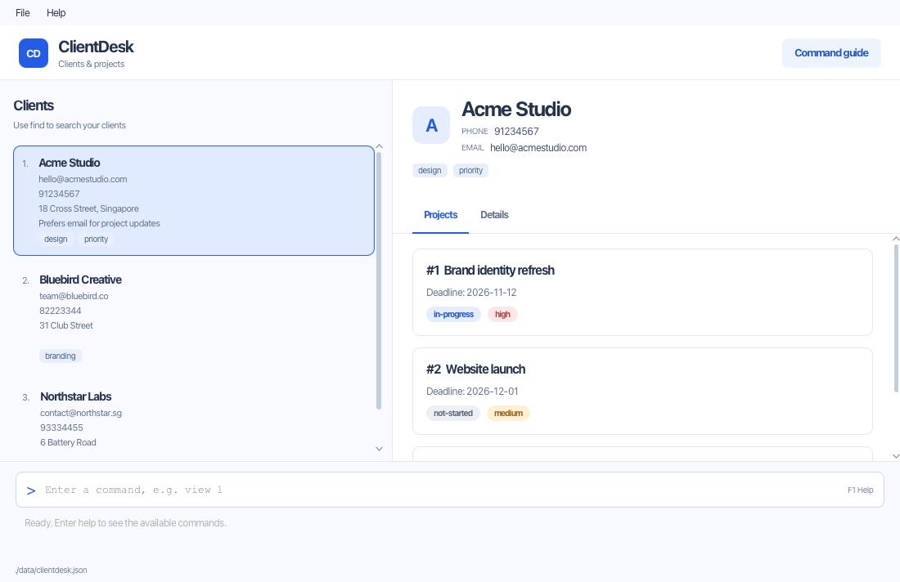

ClientDesk is a desktop application for freelancers who prefer typed commands. It manages client contact details
and records their projects, deadlines, status and priority, with a graphical client list.

* Table of Contents
{:toc}

--------------------------------------------------------------------------------------------------------------------

## Quick start

1. Ensure that Java `25` is installed on your computer.<br>
   **Mac users:** Ensure you have the precise JDK version prescribed [here](https://se-education.org/guides/tutorials/javaInstallationMac.html).

1. Download the latest `.jar` file from the [ClientDesk releases page](https://github.com/AY2627S1-CS2103T-T10-1/tp/releases)
   when a release is available. Developers can build it using the [setup instructions](SettingUp.md).

1. Copy the file to the folder you want to use as the home folder for ClientDesk.

1. Open a terminal, `cd` to the folder containing the JAR file, and run `java -jar addressbook.jar`.<br>
   A GUI similar to the one below should appear in a few seconds. Note how the app contains some sample data.<br>
   

1. Type a command in the command box and press Enter to execute it. For example, type **`help`** and press Enter to open the help window.<br>
   Some example commands you can try:

   * `list-clients` : Lists all clients.

   * `add-client n/Acme Studio p/+65 8123 4567 e/hello@acme.sg` : Creates a client.

   * `view 1` : Shows the first displayed client and their projects.

   * `help add-project` : Explains how to record work for a client.

   * `exit` : Exits the app.

1. Refer to the [Features](#features) section below for details of each command.

--------------------------------------------------------------------------------------------------------------------

## Features

<div markdown="block" class="alert alert-info">

**:information_source: Notes about the command format:**<br>

* Words in `UPPER_CASE` are the parameters to be supplied by the user.<br>
  For example, in `add n/NAME`, replace `NAME` with a value such as `John Doe`.

* Items in square brackets are optional.<br>
  For example, `n/NAME [t/TAG]` can be used as `n/John Doe t/friend` or as `n/John Doe`.

* Items followed by `…`​ can appear zero or more times.<br>
  For example, `[t/TAG]…​` may be omitted, or written as `t/friend` or `t/friend t/family`.

* Prefixed parameters can be in any order; positional indexes and project IDs must come first.<br>
  For example, if the command specifies `n/NAME p/PHONE_NUMBER`, `p/PHONE_NUMBER n/NAME` is also acceptable.

* Command words are case-insensitive. Prefixes for `add-client`, `add-project` and `edit-project` are also case-insensitive. Use lowercase prefixes for legacy `add`, `edit`, `remark` and the email-only `edit-client` command.

* Extraneous parameters for legacy `list`, `exit`, and `clear` are ignored.<br>
  For example, `list 123` is interpreted as `list`.

* Indexes refer to the **currently displayed client list**, including search results. Project IDs belong to individual clients and do not change when the list is reordered. ClientDesk has no undo command; deletions and clearing take effect without a confirmation dialog.

* If you are using a PDF version of this document, be careful when copying and pasting commands that span multiple lines as space characters surrounding line-breaks may be omitted when copied over to the application.
</div>

### Viewing help: `help`

Lists the supported ClientDesk client and project commands with short descriptions in a scrollable help window.
Supply one command name to view its purpose, format, parameter rules and examples.
Command names are case-insensitive. Help does not change client data.

Format: `help [COMMAND]`

Examples:

* `help`
* `help add-client`
* `help edit-project`
* `help remark`

An unknown command reports `Unknown command '<value>'. Type help to see all commands.`
More than one command name reports `Usage: help [COMMAND]`.

The Help menu and `F1` show the command overview. **Copy URL** copies the ClientDesk
User Guide link so you can paste it into your browser.

### Adding a client: `add-client`

Creates and saves a client, refreshes the client list and selects the new entry.

Format: `add-client n/NAME p/PHONE e/EMAIL [t/TAG]…`

Examples:

* `add-client n/Acme Studio p/+65 8123 4567 e/hello@acme.sg`
* `add-client n/Northstar Labs p/91234567 e/alex@northstar.io t/startup t/web-design`

The name, phone and email are required; tags are optional and repeatable. Parameters
can be supplied in any order. Command names and prefixes are case-insensitive.
Repeated name, phone or email prefixes and unknown prefixes are rejected.

Field | Rules
------|------
Name | 1–80 characters with at least one letter or number. Letters, numbers, spaces, apostrophes, hyphens, periods, ampersands and parentheses are allowed.
Phone | 7–15 digits, with an optional leading `+`, spaces or hyphens. Formatting is removed before storage.
Email | 3–254 characters, exactly one `@`, non-empty local and domain parts, no spaces and a dot in the domain. Domain labels cannot start or end with a hyphen.
Tag | 1–30 lowercase letters, numbers or internal hyphens; no leading or trailing hyphen. Repeated tags are stored once.

A duplicate has the same email (ignoring case), or the same name (ignoring case,
outer spaces and repeated internal spaces) **and** normalized phone. The same name
alone is allowed. Duplicates report `This client already exists: <name>.`
Missing required fields report `Usage: add-client n/NAME p/PHONE e/EMAIL [t/TAG]...`.
If saving fails, ClientDesk reports `Client could not be saved. No changes were made.`
and keeps the existing data and displayed list.

The inherited address field displays `Not provided` for a new client because
`add-client` does not require an address.
Adding a client preserves existing clients' projects and their next project IDs.
The new client starts with no projects; its first project receives ID 1.

### Listing all clients: `list-clients`

Displays all clients and resets the current search filter. Clients appear in case-insensitive name order; clients with the same name retain their creation order. The existing `list` command remains available.

Format: `list-clients`

Example: `find acme` followed by `list-clients` restores the full client list.

This command takes no arguments. Extra text, such as `list-clients extra`, reports a usage error without changing the displayed list.

### Finding clients: `find`

Finds clients using partial names, phone numbers, email addresses, or tags.

Format: `find KEYWORD [KEYWORD]...`

* Supply at least one keyword, each containing 1 to 50 characters. Separate keywords with whitespace.
* Matching is case-insensitive and uses substrings; for example, `cme` matches `Acme Studio`.
* **Every keyword must match the same client** (an `AND` search). Keywords may match different fields.
  For example, `find acme startup` matches `Acme Studio` with the tag `startup`. Each client appears once.
* Results appear in case-insensitive name order, with ties in creation order. Indexed commands use the displayed order.
* Matches produce `Found <number> matching clients.`. No matches produce `No clients matched: <keywords>.`
  and restore the full client list in name order. Feedback preserves keyword case and uses single spaces.
* Missing keywords or a keyword exceeding 50 characters produce `Usage: find KEYWORD [KEYWORD]...`.
  The previously displayed list stays visible.
* Searching does not change client records or write the data file.

Examples:

* `find acme` finds clients with `acme` in any searchable field.
* `find startup web` finds clients matching both keywords, such as clients with the tags `startup` and `webdesign`.
* `find 8123` finds clients whose phone number contains `8123`, such as `98123456`.

### Viewing client details: `view`

Displays the existing details of a client without modifying the client or the displayed list. This command does not save data.

Format: `view CLIENT_INDEX`

The index is a positive integer from the currently displayed list. After a `find` command,
use the index in the search results. Details include name, phone, email, address, remark, tags and saved projects.
Each project is shown in project-ID order with its title, deadline, status and priority.
An index outside the displayed list produces an error.

Example: `view 1` displays the first client in the current list.

### Client details panel

Enter `view INDEX` to select a client from the currently displayed list and show
contact information and saved projects in the right-hand details panel. Projects
are ordered by their stable IDs and include title, deadline, status and priority.
You can also select a client directly from the list. The panel is read-only;
scroll to read longer records and drag the divider to adjust the panel widths.
Clients without projects show `Projects: No projects yet.` When no client is
selected, the panel shows instructions. Invalid view commands retain the previous
details.

Successful `add-project`, `edit-project` and `delete-project` commands select the affected client and refresh their details automatically, including when using a filtered list. Invalid project commands and failed project saves retain the previous selection and details. Deleting the last project shows `Projects: No projects yet.`; deleting the selected client clears the panel to its instructions.

### Editing a client's email: `edit-client`

Updates a client's email while preserving their other fields, remark, projects and the current search filter.

Format: `edit-client CLIENT_INDEX e/EMAIL`

Example: `edit-client 1 e/new@example.com`

Use a positive index from the currently displayed list, including search results. Supply exactly one lowercase `e/` parameter. The email must be 3–254 characters, contain exactly one `@` and no spaces, and have a dotted domain whose labels do not start or end with a hyphen. Email duplicates are checked case-insensitively against all clients, including those hidden by a search.

Success reports `Updated client: <name>.`; an identical email reports `No changes needed for <name>.` without saving. A save failure restores the previous record. If the updated email no longer matches your search, the client may disappear from those results; use `list-clients` to find it again.

This command supports email editing only. Use the existing [Edit command](#editing-a-person-edit) to change a name, phone, address or tags. ClientDesk has no undo command.

### Setting or clearing a remark: `remark`

Stores one free-text remark for a client, such as contact preferences or a reminder. A new remark replaces the whole previous remark; it does not append to it.

Format: `remark INDEX r/[REMARK]`

* `INDEX` is a positive number from the currently displayed client list, including `find` results.
* Use lowercase `r/`, preceded by a space. Leading and trailing spaces around the remark are removed.
* Use an **empty `r/`** to clear the remark. The legacy shorthand `remark 1` also clears the first displayed client's remark.
* A successful update shows all clients and preserves the client's other fields and projects. Check the displayed indexes again after the list refreshes.
* Use `view CLIENT_INDEX` to inspect the updated remark. A missing or out-of-range client index reports an error without updating any record.

Examples (each uses the first currently displayed client):

* `remark 1 r/Prefers email contact.` sets the remark.
* `remark 1 r/Call after 2 pm.` replaces it.
* `remark 1 r/` removes it.

A non-empty remark reports `Added remark to person: <details>`; clearing reports `Removed remark from person: <details>`. These legacy messages refer to the client you selected by index.

### Adding a project: `add-project`

Records work under a client and saves it immediately.
Use `view CLIENT_INDEX` to see saved projects and their IDs, and `edit-project` to update an existing project.

Format: `add-project CLIENT_INDEX title/TITLE deadline/DATE [status/STATUS] [priority/PRIORITY]`

Examples:

* `add-project 1 title/Website redesign deadline/2026-10-15`
* `add-project 2 title/Landing page deadline/2026-09-25 status/in-progress priority/high`
* `find acme` followed by `add-project 1 title/UI/UX refresh deadline/2026-12-01 priority/low`

Parameter | Rules
----------|------
`CLIENT_INDEX` | A positive integer in the currently displayed client list, including `find` results; no sign or decimal.
`TITLE` | 1–100 printable Unicode characters after surrounding spaces are removed, including at least one letter or number. Titles cannot contain control characters or invisible formatting characters.
`DATE` | A real date in exactly `yyyy-MM-dd` form, with a year from `0001` to `9999`.
`STATUS` | `not-started` (default) or `in-progress`. A new project cannot be `completed`.
`PRIORITY` | `low`, `medium` (default) or `high`.

Parameters may appear in any order. Each prefix must appear at most once. The command, prefixes, status and priority
are case-insensitive. Use spaces between parameters. Inside a title, slash-containing words such as `UI/UX`
are ordinary text; a whitespace-separated `title/`, `deadline/`, `status/` or `priority/` starts a parameter and cannot
be used as literal title text.

On success, ClientDesk reports `Added project #<id> to <client>.` Project IDs start at
1 independently for each client and increase after successful saves. A past deadline is accepted and adds
`Warning: This project is overdue.`. Today's deadline is not overdue; the comparison uses your computer's local date.

A project is a duplicate when the same client already has its title and deadline. Title comparison ignores case,
surrounding spaces and repeated spaces, including Unicode spaces. Status and priority do not affect duplicate
handling. A duplicate reports `This project already exists for <client>.`; matching projects under different clients
are allowed.

Invalid input reports the relevant title, deadline, status, priority or index constraint. Missing required parameters
report `Usage: add-project CLIENT_INDEX title/TITLE deadline/DATE [status/STATUS] [priority/PRIORITY]`.
A failed save reports `Project could not be saved. No changes were made.`. The existing data and displayed list stay
unchanged, and retrying can use the same project ID.

### Editing a project: `edit-project`

Updates an existing project's title, deadline, status or priority. Use this when a client revises the work, a deadline moves, or a project is completed. Editing keeps the project's ID and does not consume a new ID.

Format: `edit-project CLIENT_INDEX PROJECT_ID [title/TITLE] [deadline/DATE] [status/STATUS] [priority/PRIORITY]`

`CLIENT_INDEX` is the positive number beside a client in the currently displayed list. After `find`, use the number in those search results. `PROJECT_ID` is the positive ID shown by `view CLIENT_INDEX`, **not the project's position in the displayed project list**. Both identifiers must be unsigned ASCII integers from 1 to 2147483647, without a sign or decimal. IDs belong to individual clients, so two clients can each have project #1.

Supply at least one field. Fields you omit retain their existing values. The client index and project ID come first; the prefixed fields may follow in any order. Command words, prefixes, status and priority are case-insensitive. Titles retain their capitalization and internal spacing.

| Field | Accepted values |
| --- | --- |
| `title/TITLE` | 1–100 printable Unicode code points after removing surrounding spaces, including at least one letter or number. Control characters, invisible formatting characters and unpaired surrogates are invalid. |
| `deadline/DATE` | A real date in `yyyy-MM-dd` format, with a year from 0001 to 9999. Past dates are allowed. For example, `2024-02-29` is valid and `2026-02-29` is invalid. |
| `status/STATUS` | `not-started`, `in-progress` or `completed`. Completed work can be reopened with either of the first two values. |
| `priority/PRIORITY` | `low`, `medium` or `high`. |

A supplied field cannot be blank or repeated. Only `title/`, `deadline/`, `status/` and `priority/` delimit fields. Ordinary slash-containing title words such as `UX/UI` and `https://example.com` remain title text. A whitespace-separated recognized prefix starts another field, so a title cannot contain a separate token such as `status/` as ordinary text.

**Example:** suppose `view 1` shows Acme Studio's project #11, “Website redesign”.

```text
view 1
edit-project 1 11 status/completed
edit-project 1 11 title/Website launch deadline/2026-10-30 priority/high
```

The first edit changes only the status. The second changes the title, deadline and priority; the status remains `completed`. The second success message is:

```text
Updated project #11 for Acme Studio: Website launch | Deadline: 2026-10-30 | Status: completed | Priority: high
```

The updated client is selected and the current client filter is preserved. Use `view 1` again to inspect its projects. Changes are saved automatically and survive restarting ClientDesk. Other clients and projects are unchanged.

Two projects for the same client cannot have the same normalized title and deadline. Title comparison ignores case and repeated spaces, regardless of status or priority. The same title with a different deadline, or matching work under another client, is allowed.

| Situation | Result |
| --- | --- |
| Omitted edit fields, such as `edit-project 1 11` | `Specify at least one project field to update.` |
| No displayed client at index 99 | `No client at index 99.` |
| No project #99 for Acme Studio | `No project with ID 99 for Acme Studio.` |
| Edit would duplicate another project for the same client | `Update would duplicate another project for this client.` |
| Supplied values are identical to the existing values | `No changes needed for project #11.` No save occurs. |
| Saving fails | `Project could not be saved. No changes were made.` Previous live and saved data are retained. |

Invalid identifiers, dates, statuses, priorities, repeated fields and unexpected positional text produce an error without changing project data. Editing requires an existing project; use `view` to find its ID. Older client files without projects continue to load normally, but have no projects to edit.

### Deleting a project: `delete-project`

Removes one project from a client. Use `view CLIENT_INDEX` to find a project's ID.

Format: `delete-project CLIENT_INDEX PROJECT_ID`

* `CLIENT_INDEX` is a positive integer in the currently displayed client list, including `find` results.
* `PROJECT_ID` is a positive integer belonging to that client. Project IDs are client-scoped.
* A successful deletion is saved immediately. The next project ID is retained, so a deleted ID is not reused.
* If the client index or project ID is invalid, no data changes. If saving fails, the project remains in the client record.

Example: `delete-project 1 2` removes project 2 from the first displayed client.

### Deleting a client: `delete-client`

Removes a client from ClientDesk using the index in the currently displayed list. The command also works after `find`; use the displayed result index.

Format: `delete-client CLIENT_INDEX`

* `CLIENT_INDEX` must be a positive integer shown in the client list.
* Deletion is saved immediately and cannot be undone in the app.
* If saving fails, ClientDesk reports an error and keeps the client in the list.

Example: `delete-client 3` removes the third displayed client.

### Adding a person: `add`

Adds a client with an address using the legacy command. For formatted phone numbers and creation without an address, use [Add Client](#adding-a-client-add-client). Both commands create records in the same client list.

Format: `add n/NAME p/PHONE_NUMBER e/EMAIL a/ADDRESS [t/TAG]…​`

<div markdown="span" class="alert alert-primary">:bulb: **Tip:**
A client can have any number of tags, including zero.
</div>

Examples:

* `add n/John Doe p/98765432 e/johnd@example.com a/John street, block 123, #01-01`
* `add n/Betsy Crowe t/friend e/betsycrowe@example.com a/Newgate Prison p/1234567 t/criminal`

Name, phone, email and address are required. Tags are optional and repeatable. Use lowercase prefixes and separate parameters with spaces; repeating `n/`, `p/`, `e/` or `a/` is rejected.

Field | Legacy Add/Edit rules
------|------
Name | 1–80 characters containing at least one letter or number; allows letters, numbers, spaces, apostrophes, hyphens, periods, ampersands and parentheses.
Phone | At least 3 digits, with no spaces, hyphens or leading `+`. This differs from `add-client`'s 7–15-digit formatted-phone rule.
Email | 3–254 characters, exactly one `@`, no spaces, and a dotted domain whose labels do not start or end with a hyphen.
Address | A non-blank value.
Tag | 1–30 letters, numbers or internal hyphens. Uppercase is accepted and preserved; `add-client` requires lowercase tags.

A duplicate is a client with the same email ignoring case, or the same normalized name and phone. The same name alone is allowed. A new legacy record starts with no projects or remark.

### Listing all persons: `list`

Displays all clients and clears the active search filter, using the same case-insensitive name order as `list-clients`. Clients with equal names retain their creation order. Extra arguments are ignored; prefer `list-clients` if you want an error for unexpected text.

Format: `list`

### Editing a person: `edit`

Edits an existing client's contact information or tags using the legacy command. The [legacy field rules](#adding-a-person-add) apply. Use lowercase prefixes; repeating `n/`, `p/`, `e/` or `a/` is rejected. Remarks, projects and omitted fields are preserved. A successful edit shows all clients, so check the displayed indexes before the next command.

Format: `edit INDEX [n/NAME] [p/PHONE] [e/EMAIL] [a/ADDRESS] [t/TAG]…​`

* Edits the person at the specified `INDEX`. The index refers to the index number shown in the displayed person list. The index **must be a positive integer** 1, 2, 3, …​
* At least one of the optional fields must be provided.
* Existing values will be updated to the input values.
* When editing tags, all of the person's existing tags are removed; adding tags is not cumulative.
* To remove all of a person's tags, enter `t/` without a tag after it.

Examples:

*  `edit 1 p/91234567 e/johndoe@example.com` Edits the phone number and email address of the 1st person to be `91234567` and `johndoe@example.com` respectively.
*  `edit 2 n/Betsy Crower t/` Edits the name of the 2nd person to be `Betsy Crower` and clears all existing tags.

### Deleting a person: `delete`

Deletes the specified person from the address book.

Format: `delete INDEX`

* Deletes the person at the specified `INDEX`.
* The index refers to the index number shown in the displayed person list.
* The index **must be a positive integer** 1, 2, 3, …​

Examples:

* `list` followed by `delete 2` deletes the 2nd person in the address book.
* `find Betsy` followed by `delete 1` deletes the 1st person in the results of the `find` command.

The client's remark and projects are removed with the client. There is no confirmation dialog and no undo.

### Clearing all entries: `clear`

Removes **every client, remark and project**, including clients hidden by a search. There is no confirmation dialog and no undo. Back up your data before clearing it. This command takes no parameters; extra text is ignored.

Format: `clear`

### Exiting the program: `exit`

Closes ClientDesk. Successful data changes are saved automatically. No parameters are needed; extra text is ignored.

Format: `exit`

### Saving the data

ClientDesk automatically saves successful data changes. You do not need to save manually.
`add-project` saves before displaying success, and projects survive restarting the application.
`find`, `help` and `list-clients` do not write the data file.

### Editing the data file

ClientDesk data is saved automatically as a JSON file `[JAR file location]/data/addressbook.json`. Advanced users are
welcome to update data directly by editing that file. Back up the file first. Each client's `projects` array stores
project IDs, titles, deadlines, status and priority. Preserve the `nextProjectId` counter, which must be greater than
every existing project ID. Files created before project support still load with no projects.

Keep the new JAR in your existing ClientDesk home folder when upgrading. If an older version was launched from
a different working directory, back up and copy its `data` folder and `preferences.json` into the folder containing
the new JAR before starting this version. Data, preferences and logs now use the JAR's folder regardless of the
terminal's working directory.

<div markdown="span" class="alert alert-warning">:exclamation: **Caution:**
If ClientDesk cannot read or validate an existing data file, it shows an error identifying the file and closes
without opening the command window. The original file remains unchanged. Back it up, then restore a valid copy
or correct the file and restart ClientDesk. The application log contains further details.<br>
A genuinely missing data file still starts the app with sample clients. Back up existing data before editing it
and keep field values within the documented limits.
</div>

--------------------------------------------------------------------------------------------------------------------

## FAQ

**Q**: How do I transfer my data to another computer?<br>
**A**: Close ClientDesk on both computers. Install ClientDesk on the new computer, then copy
`data/addressbook.json` from the folder containing your old ClientDesk JAR to the corresponding `data` folder beside
the new JAR, replacing the file there. Keep a backup of both files until you have opened ClientDesk and verified the
transferred clients and projects.

--------------------------------------------------------------------------------------------------------------------

## Known issues

1. **When using multiple screens**, if you move the application to a secondary screen, and later switch to using only the primary screen, the GUI will open off-screen. The remedy is to delete the `preferences.json` file created by the application before running the application again.

--------------------------------------------------------------------------------------------------------------------

## Command summary

Action | Format, Examples
--------|------------------
**Help** | `help [COMMAND]`<br>e.g., `help remark`
**Add Client** | `add-client n/NAME p/PHONE e/EMAIL [t/TAG]…`<br>e.g., `add-client n/Acme Studio p/+65 8123 4567 e/hello@acme.sg`
**List Clients** | `list-clients`
**Find** | `find KEYWORD [KEYWORD]...`<br>e.g., `find acme startup`
**View** | `view CLIENT_INDEX`<br>e.g., `view 1`
**Edit Client** | `edit-client CLIENT_INDEX e/EMAIL`<br>e.g., `edit-client 1 e/new@acme.sg`
**Remark** | `remark INDEX r/[REMARK]`<br>e.g., `remark 1 r/Prefers email contact.`; clear with `remark 1 r/`
**Add Project** | `add-project CLIENT_INDEX title/TITLE deadline/DATE [status/STATUS] [priority/PRIORITY]`<br>e.g., `add-project 1 title/Website deadline/2026-10-15 priority/high`
**Edit Project** | `edit-project CLIENT_INDEX PROJECT_ID [title/TITLE] [deadline/DATE] [status/STATUS] [priority/PRIORITY]`<br>e.g., `edit-project 1 2 status/completed`
**Delete Project** | `delete-project CLIENT_INDEX PROJECT_ID`<br>e.g., `delete-project 1 2`
**Delete Client** | `delete-client CLIENT_INDEX`<br>e.g., `delete-client 3`
**Add (legacy)** | `add n/NAME p/PHONE e/EMAIL a/ADDRESS [t/TAG]…`<br>e.g., `add n/James Ho p/22224444 e/jamesho@example.com a/123, Clementi Rd t/friend`
**List (legacy)** | `list`
**Edit (legacy)** | `edit INDEX [n/NAME] [p/PHONE] [e/EMAIL] [a/ADDRESS] [t/TAG]…`<br>e.g., `edit 2 n/James Lee e/jameslee@example.com`
**Delete (legacy)** | `delete INDEX`<br>e.g., `delete 3`
**Clear** | `clear`
**Exit** | `exit`
